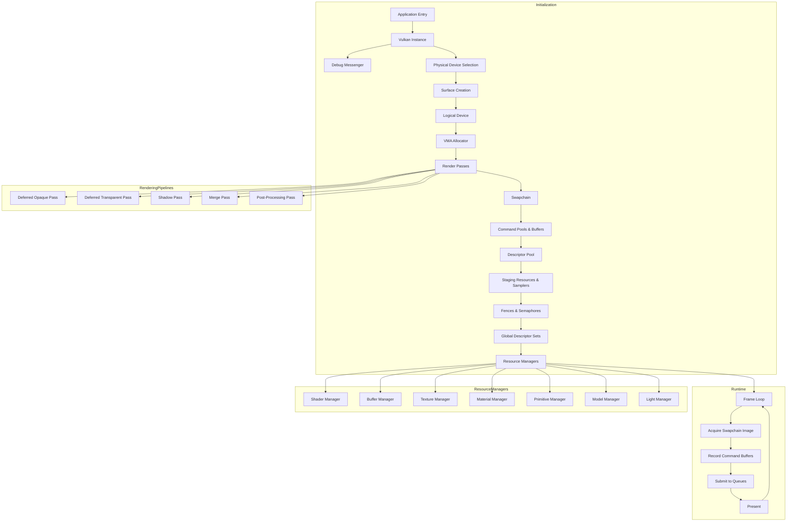
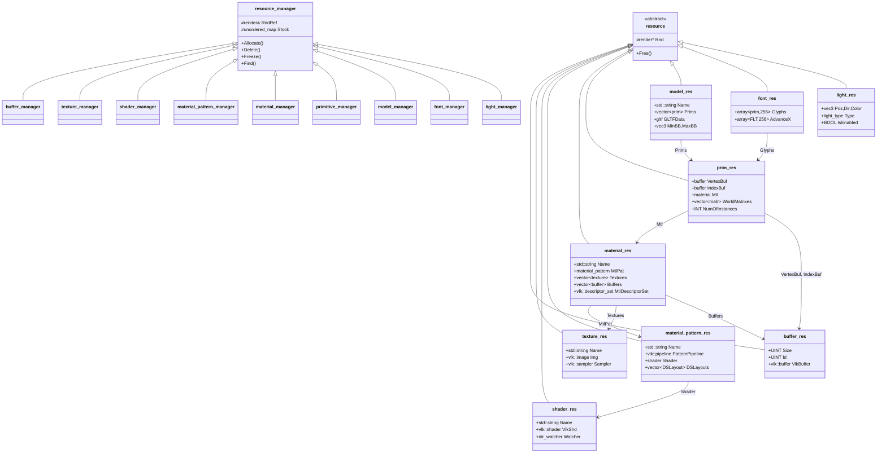
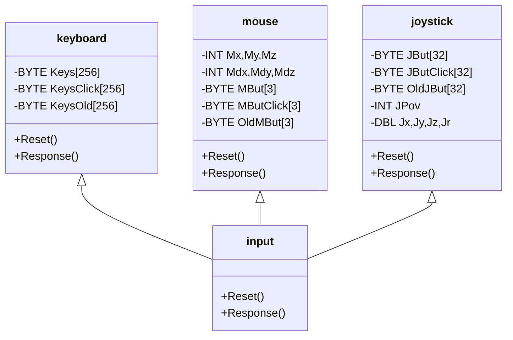
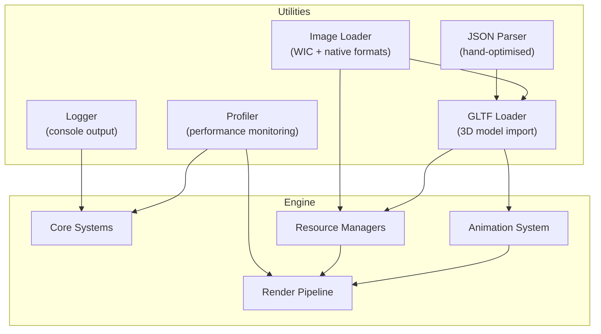
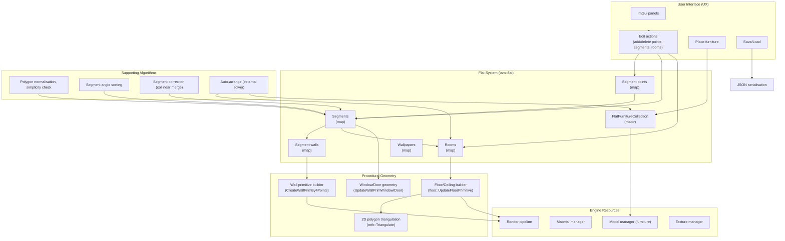
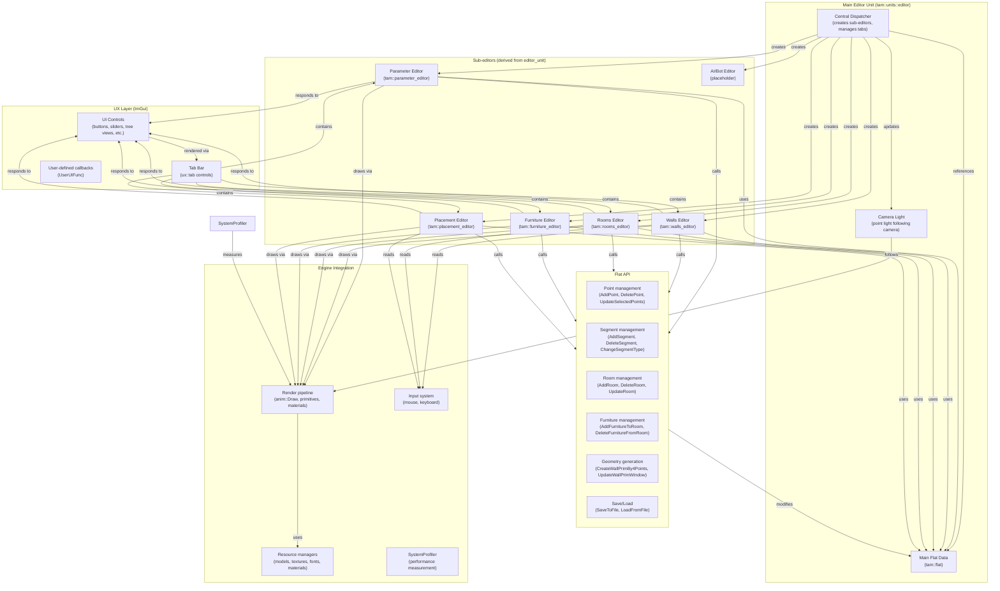
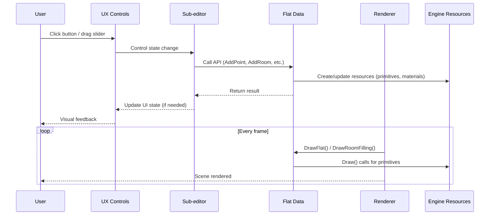
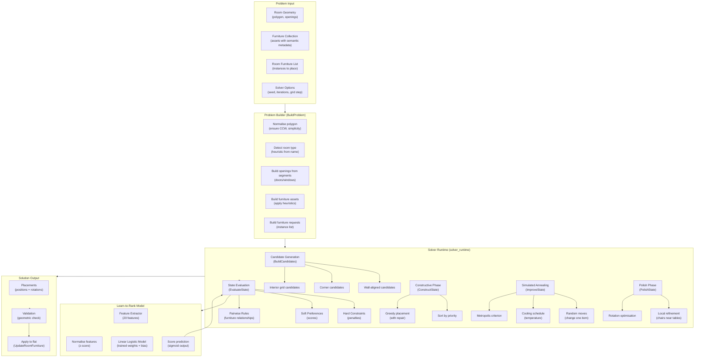

# Coding Standards

## 1. General Code Formatting Rules

Here is described the coding style, documentation requirements, and naming conventions used throughout the project.

The purpose of these rules is to maintain consistency, readability, and long-term maintainability of the codebase.

All source files must follow the requirements described below.

Everyone should avoid temorary and informal comments. Also function's implementations and declarations should be in a logical order.

All code formatting rules spread only on GLSL, C++ and C. Other languages, that can be used as tools could not follow all the rules!
---

## 2. File Header Documentation

Each source file must begin with a standard header containing copyright information, file description, authors, and update information.

Required format:

```cpp
/***************************************************************
 * Copyright (C) 2026
 *    Computer Graphics Support Group of 30 Phys-Math Lyceum
 ***************************************************************/

/* FILE NAME   : ...
 * PURPOSE     : Tough Arrangement Manager project.
 *               ... file.
 * PROGRAMMER  : CGSG'Sr'2025.
 *               Kochugueva Maria (MK3),
 *               Arsentev Artemy (AA4),
 *               Nechaev Vladimir (VN4),
 *               Kupchenkov Ivan (IK4),
 *               Novozhilova Maryana (MN7),
 *               Tretyakov Andrey (AT7),
 *               Vitaly A. Galinsky (VG4).
 * LAST UPDATE : dd.mm.yyyy
 * NOTE        : Namespace 'tam'.
 *
 * No part of this file may be changed without agreement of
 * Computer Graphics Support Group of 30 Phys-Math Lyceum
 */
```

Every file must end with:

```cpp
/* END OF 'FILE_NAME' FILE */
```

The closing marker must contain the exact file name.

---

## 3. Namespace Documentation

Every namespace must have a description before its declaration.

Example:

```cpp
/* 'tam' namespace */
namespace tam
{
...
} /* end of 'tam' namespace */
```

The closing namespace comment is mandatory.

---

## 4. Class, Structure, and Enumeration Documentation

Every class, structure, enumeration, and other major logical entity must have a descriptive comment before declaration.

The comment must describe the purpose of the entity.

Example:

```cpp
/* Vulkan buffer class */
class Buffer
{
  ...
};
/* End of 'Buffer' class */
```

Required closing comments:

```cpp
/* End of 'ClassName' class */

/* End of 'StructureName' structure */

/* End of 'EnumName' enum */
```

Documentation is required for:

- Classes
- Structures
- Enumerations
- Type definitions
- Major logical components

---

## 5. Member Variable Documentation

Every class and structure field must contain a comment describing its purpose or role.

Example:

```cpp
class Room
{
  Vec3 Position;   // Room position in world coordinates
  Vec2 Size;       // Room dimensions
  bool IsVisible;  // Current visibility state
};
```

Comments must describe the meaning of the variable.

Incorrect:

```cpp
int Count; // Integer variable
```

Correct:

```cpp
int Count; // Number of furniture objects in the room
```

---

## 6. Function Documentation

Every function must contain a documentation block before implementation.

Required format:

```cpp
/* Calculate furniture placement score function.
 * ARGUMENTS:
 *   - Room:
 *       room Room;
 *   - Furniture list:
 *       furniture;
 *
 * RETURNS:
 *   (double) calculated layout score.
 */
```

The documentation must contain:

- Function purpose.
- Description of every argument.
- Return value description.

Every argument must be documented, including functions with no arguments.

For functions without arguments:

```cpp
 * ARGUMENTS: None.
```

For functions with void return:

```cpp
 * RETURNS: None.
```

All arguments must be written with indentation from the parentheses:

Correct:

```cpp
Function( int Value );
```

Incorrect:

```cpp
Function(int Value);
```

Every function must end with:

```cpp
/* End of 'FunctionName' function */
```

---

## 7. Constructor and Destructor Documentation

Constructors and destructors have simplified documentation requirements.

Constructor:

```cpp
/* Room constructor */

/* End of 'Room' constructor */
```

Destructor:

```cpp
/* Room destructor */

/* End of 'Room' destructor */
```

---

## 8. Naming Conventions

### 8.1 General Naming Rule

All function and variable names must use **PascalCase** notation.

Examples:

Correct:

```cpp
CalculateLayoutScore()

FurnitureManager

RoomObject
```

Incorrect:

```cpp
calculate_layout_score()

furniture_manager

room_object
```

---

## 9. File and Class Naming

Files and classes must use lowercase letters with underscores.

Examples:

Correct:

```
room_manager.cpp

furniture_layout.h

placement_engine.cpp

class render_config

class anim
```

Incorrect:

```
RoomManager.cpp

FurnitureLayout.h

PlacementEngine.cpp

class RenderConfig

class Anim
```

---

## 10. Constants and Preprocessor Definitions

Constants and preprocessor definitions must use uppercase letters with underscores.

Examples:

Correct:

```cpp
#define MAX_ROOM_SIZE 100

const int DEFAULT_OBJECT_COUNT = 32;
```

Incorrect:

```cpp
#define MaxRoomSize 100

const int DefaultObjectCount = 32;
```

---

## 11. Type Naming Convention

All custom types must follow the naming convention defined in the project common header (`commondf.h`).

Types must use uppercase naming according to the project standard.

Example:

```cpp
typedef struct
{
  ...
} TAM_ROOM;
```

All project-specific types must use the common project type system.

---

## 12. Indentation and Bracket Style

The project uses:

- Two spaces for indentation.
- Opening and closing brackets on separate lines.

Example:

```cpp
if (Condition)
{
  Execute();
}
```

Loops and conditional statements containing only one operation should avoid unnecessary brackets.

Example:

```cpp
if (Ready)
  Start();
```

---

## 13. Code Organization Rules

Source files should be organized in the following order:

1. File header.
2. Include directives.
3. Namespace declaration.
4. Type declarations.
5. Class and structure implementations.
6. Function implementations.
7. File closing marker.

Example:

```cpp
#include "file.h"

/* 'tam' namespace */
namespace tam
{
/* Class declaration */

/* Function implementation */

} /* end of 'tam' namespace */

/* END OF 'file.cpp' FILE */
```

---

## 14. Template Comment Requirement

All provided documentation templates are mandatory.

The same type of code entities must always use the same documentation format.

Required templates:

- File headers.
- Namespace comments.
- Class comments.
- Structure comments.
- Enumeration comments.
- Function comments.
- Constructor and destructor comments.
- Closing markers.

Consistency of documentation style is required throughout the entire project.

---

## 15. General Code Quality Requirements

Developers should:

- Keep functions focused on a single responsibility.
- Avoid unnecessary complexity.
- Use meaningful names.
- Avoid duplicated code.
- Maintain consistent formatting.
- Update documentation after changing functionality.

All changes must preserve the existing coding style.

# 1. Window System

## 1.1 Purpose

The window subsystem provides the application's primary interface with the Microsoft Windows operating system.

It is responsible for:

- Registering the application window class.
- Creating and destroying the main application window.
- Processing the operating system message queue.
- Dispatching system events to the engine.
- Managing the application lifecycle.
- Providing a unified abstraction layer over the Win32 API.

The implementation is located in:

```
tam_win.cpp
tam_win.h
```

The subsystem is intentionally isolated from rendering, resource management, and editor logic. Its only responsibility is interaction with the operating system.

---

## 1.2 Why Win32 API

The project uses the native Win32 API instead of third-party window libraries such as GLFW or SDL.

We usually use Win32 API because of several reasons:

- Complete access to the Windows message system.
- Direct integration with Dear ImGui Win32 backend.
- Full control over window creation and management.
- No additional runtime dependencies.
- Lower abstraction overhead.
- Better compatibility with the custom rendering framework.

---

## 1.3 Window Class Registration

Before any window can be created, Windows requires registration of a window class.

The registration process defines how all future windows of this class behave.

The implementation first checks whether the class has already been registered:

```cpp
GetClassInfo(...)
```

This prevents duplicate registration if multiple windows are created during the application lifetime.

If the class is not registered, a new `WNDCLASS` structure is initialized.

Important parameters:

| Parameter | Description |
|-----------|-------------|
| `style` | Window redraw policy and double-click support |
| `lpfnWndProc` | Pointer to the main message processing procedure |
| `cbWndExtra` | Additional memory reserved for storing the class instance pointer |
| `hCursor` | Default mouse cursor |
| `hIcon` | Application icon |
| `lpszClassName` | Unique class identifier |

The chosen style flags are:

```cpp
CS_HREDRAW
CS_VREDRAW
CS_DBLCLKS
```

Their purpose is:

- automatic redraw after horizontal resize;
- automatic redraw after vertical resize;
- generation of double-click mouse events.

The callback function

```cpp
WinFunc(...)
```

becomes the central dispatcher of every operating system event.

---

## 1.4 Thread Safety During Window Creation

Window creation is protected by a recursive mutex.

```cpp
static std::recursive_mutex win_mutex;
```

The mutex guarantees that only one thread may create or register the window class at any given time.

Although the current application creates only one window, this approach makes the subsystem safe for future multithreaded extensions.

---

## 1.5 Window Creation

After successful registration, the main application window is created.

The implementation uses the Win32 function

```cpp
CreateWindow(...)
```

The following parameters are specified.

### Window Class

The previously registered class name.

```
WindowClassName
```

### Window Title

```
CGSG::TAM Project
```

The title appears in the operating system title bar.

### Window Style

```
WS_OVERLAPPEDWINDOW
WS_VISIBLE
```

The selected style provides:

- title bar;
- system menu;
- minimize button;
- maximize button;
- resizing borders;
- automatic visibility immediately after creation.

The initial position and size use

```cpp
CW_USEDEFAULT
```

allowing Windows to determine the most appropriate initial placement.

The final argument passed to `CreateWindow` is

```cpp
reinterpret_cast<VOID *>(this)
```

This pointer transfers ownership of the current C++ object to the operating system.

It allows the window procedure to recover the corresponding class instance after receiving the `WM_CREATE` message.

---

## 1.6 Associating the Window with the C++ Object

The Win32 API operates using procedural callbacks rather than object-oriented methods.

To bridge this difference, the project stores the pointer to the current `win` object inside the window's extra memory.

During processing of `WM_CREATE`, the pointer received from `CreateWindow()` is stored using

```cpp
SetWindowLongPtr(...)
```

Subsequent messages retrieve this pointer using

```cpp
GetWindowLongPtr(...)
```

After retrieval, the callback converts it back into

```cpp
win *
```

using

```cpp
reinterpret_cast
```

From this point onward, every operating system event can be redirected to the appropriate object instance.

This mechanism allows the project to preserve an object-oriented architecture while using the procedural Win32 message model.

---

## 1.7 Showing the Window

After successful creation, the window becomes visible using

```cpp
ShowWindow(...)
```

The selected display mode

```cpp
SW_SHOWNORMAL
```

opens the application in its normal state without forcing maximized or minimized presentation.

Window painting is then handled automatically by the operating system through the message queue.

---

## 1.8 Main Message Loop

The application's execution is driven entirely by the Windows message loop.

The implementation repeatedly calls

```cpp
PeekMessage(...)
```

instead of

```cpp
GetMessage(...)
```

Unlike `GetMessage`, `PeekMessage` does not block the executing thread.

This design allows the engine to perform rendering, simulation, and background tasks whenever no operating system messages are waiting.

The processing pipeline is therefore:

```
Operating System

        ↓

PeekMessage()

        ↓

TranslateMessage()

        ↓

DispatchMessage()

        ↓

WinFunc()

        ↓

Corresponding Event Handler
```

The loop terminates only after receiving

```cpp
WM_QUIT
```

which signals application shutdown.

---

## 1.9 Window Procedure

The function

```cpp
WinFunc(...)
```

acts as the central dispatcher for every event generated by the operating system.

Its responsibilities include:

- keyboard input;
- mouse input;
- window resizing;
- activation state;
- painting requests;
- menu processing;
- drag-and-drop operations;
- timers;
- scrolling;
- full-screen transitions;
- application shutdown.

Rather than implementing application logic directly, the procedure forwards each message to the corresponding member function of the `win` class.

This design keeps the dispatcher lightweight while encapsulating behavior inside dedicated event handlers.

---

## 1.10 Event-Oriented Architecture

The window subsystem follows an event-driven architecture.

Each Windows message corresponds to a dedicated virtual handler.

Examples include:

| Windows Message | Handler |
|-----------------|---------|
| `WM_CREATE` | `OnCreate()` |
| `WM_SIZE` | `OnSize()` |
| `WM_PAINT` | `OnPaint()` |
| `WM_MOUSEMOVE` | `OnMouseMove()` |
| `WM_KEYDOWN` | `OnKey()` |
| `WM_TIMER` | `OnTimer()` |
| `WM_COMMAND` | `OnCommand()` |
| `WM_DESTROY` | `OnDestroy()` |

Separating event dispatching from event implementation significantly improves readability, extensibility, and maintainability of the subsystem.

Future functionality can be introduced by overriding or extending individual handlers without modifying the central dispatcher.

# Vulkan Low-Level Graphics System

## Low‑Level Graphics System Architecture



### Explanation

- **Initialization** flow (top to bottom) shows the strict ordering of Vulkan object creation – each block depends on the previous.  
- **Runtime** loop demonstrates the per‑frame cycle after all resources are set up.  
- **Resource Managers** are grouped to highlight the central role they play in supplying assets to the rendering passes.  
- **Rendering Pipelines** branch from the render passes subsystem, indicating the multiple pass types used in deferred shading.

---

## 1. Vulkan Instance

### 1.1 Purpose

The Vulkan instance serves as the foundational entry point for all Vulkan operations within the application. It establishes the connection between the application and the Vulkan runtime, enabling access to device enumeration, extension management, and layer configuration.

The instance is responsible for:
- Initializing the Vulkan runtime environment.
- Enabling required instance-level extensions.
- Configuring validation layers for debugging.
- Providing the base context for subsequent Vulkan object creation.

### 1.2 Implementation

The instance creation process follows Vulkan best practices, with careful consideration given to extension and layer selection:

```cpp
BOOL tam::vlk::instance::Create( VOID )
{
  VkApplicationInfo ApplicationInfo
  {
    .sType = VK_STRUCTURE_TYPE_APPLICATION_INFO,
    .pApplicationName = "TAM Vulkan Animation Project",
    .applicationVersion = 1,
    .apiVersion = VK_MAKE_VERSION(1, 4, 0),
  };

  VkInstanceCreateInfo InstanceCreateInfo
  {
    .sType = VK_STRUCTURE_TYPE_INSTANCE_CREATE_INFO,
    .pApplicationInfo = &ApplicationInfo,
  };
```

### 1.3 Extension Selection

The instance enables extensions based on platform requirements and debug needs:

| Extension | Purpose |
|-----------|---------|
| `VK_KHR_SURFACE_EXTENSION_NAME` | Core surface presentation capability |
| `VK_KHR_WIN32_SURFACE_EXTENSION_NAME` | Windows-specific surface integration |
| `VK_EXT_DEBUG_UTILS_EXTENSION_NAME` | Validation and debugging (debug builds) |
| `VK_EXT_VALIDATION_FEATURES_EXTENSION_NAME` | Extended validation features (debug builds) |

The selection process involves querying available extensions and conditionally enabling debug-related extensions only in non-release builds, maintaining optimal performance in production environments.

### 1.4 Layer Configuration

Validation layers are enabled exclusively in debug builds, providing comprehensive error checking and diagnostic information:

```cpp
std::vector<const CHAR *> EnabledLayersNames {};
for (auto &layer : LayerProperties)
  if (strcmp("VK_LAYER_KHRONOS_validation", layer.layerName) == 0)
  {
#ifndef NDEBUG
    EnabledLayersNames.push_back("VK_LAYER_KHRONOS_validation");
#endif
    break;
  }
```

The validation configuration enables two critical features:
- **GPU-Assisted Validation**: Detects shader-related errors through GPU instrumentation.
- **Best Practices Validation**: Identifies suboptimal patterns that may affect performance.

### 1.5 Version Targeting

The implementation targets Vulkan API version 1.4.0, balancing modern feature availability with broad hardware compatibility. This version selection ensures access to recent improvements in pipeline creation, descriptor management, and synchronization primitives.

---

## 2. Vulkan Debugging Infrastructure

### 2.1 Purpose

The debugging infrastructure provides comprehensive diagnostic capabilities for Vulkan operations, enabling developers to identify and resolve issues during development. This system integrates with the Vulkan validation layers and provides a human-readable interface for interpreting validation messages.

The debugging system is responsible for:
- Capturing validation layer messages.
- Parsing and formatting debug output.
- Color-coded message presentation.
- Object reference tracking.
- Message severity classification.

### 2.2 Implementation

The debug infrastructure consists of two primary components: the debug messenger creation and the custom message parser.

```cpp
VkDebugUtilsMessengerCreateInfoEXT DebugUtilsMessengerCreateInfo
{
  .sType = VK_STRUCTURE_TYPE_DEBUG_UTILS_MESSENGER_CREATE_INFO_EXT,
  .messageSeverity = VK_DEBUG_UTILS_MESSAGE_SEVERITY_VERBOSE_BIT_EXT |
                     VK_DEBUG_UTILS_MESSAGE_SEVERITY_WARNING_BIT_EXT | 
                     VK_DEBUG_UTILS_MESSAGE_SEVERITY_ERROR_BIT_EXT |
                     VK_DEBUG_UTILS_MESSAGE_SEVERITY_INFO_BIT_EXT,
  .messageType = VK_DEBUG_UTILS_MESSAGE_TYPE_GENERAL_BIT_EXT |
                 VK_DEBUG_UTILS_MESSAGE_TYPE_VALIDATION_BIT_EXT |
                 VK_DEBUG_UTILS_MESSAGE_TYPE_PERFORMANCE_BIT_EXT,
```

### 2.3 Message Classification

Debug messages are classified by severity and type:

**Severity Levels:**
- **VERBOSE**: Detailed diagnostic information.
- **INFO**: General informational messages.
- **WARNING**: Non-critical issues that may indicate problems.
- **ERROR**: Critical failures requiring developer attention.

**Message Types:**
- **GENERAL**: Runtime and system-level messages.
- **VALIDATION**: API usage validation errors.
- **PERFORMANCE**: Performance-related warnings and recommendations.

### 2.4 Custom Message Parsing

The implementation includes a sophisticated message parser that enhances readability through color coding and semantic highlighting:

- **Vulkan API Elements** (`VK_*`, `vk*`, `Vk*`): Highlighted for easy identification.
- **Layer Validation IDs** (`VUID-*`, `UNASSIGNED-*`): Distinct formatting for error codes.
- **File Paths**: Emphasized to aid in debugging.
- **Hexadecimal Values**: Color-coded for visibility.

### 2.5 Console Integration

Debug output is directed to the console with ANSI color codes, providing immediate visual feedback during development. This integration maintains a clear distinction between debug information and application output through color-coded formatting:

```
<Color>Severity</Color> <Color>Types</Color> <Parsed Message>
```

---

## 3. Physical Device Selection

### 3.1 Purpose

The physical device selection subsystem identifies and chooses the most suitable GPU for the application's needs. This process involves enumerating available devices, evaluating their capabilities, and selecting the optimal device based on performance characteristics and feature support.

The subsystem is responsible for:
- Enumerating available physical devices.
- Evaluating device capabilities.
- Selecting the optimal device.
- Querying device properties and features.
- Memory heap and type analysis.

### 3.2 Implementation

Device selection follows a structured evaluation process that considers multiple factors:

```cpp
BOOL tam::vlk::physdevice::Create( VOID )
{
  // Get number of physical devices
  UINT32 PhysicalDeviceCount = 0;
  vkEnumeratePhysicalDevices(VlkRef->Instance, &PhysicalDeviceCount, nullptr);
  
  // Obtain physical devices
  std::vector<VkPhysicalDevice> PhysDevices(PhysicalDeviceCount);
  vkEnumeratePhysicalDevices(VlkRef->Instance, &PhysicalDeviceCount, PhysDevices.data());
  
  // Choose the best device
  UINT64 CurVideoMemory = 0;
  for (VkPhysicalDevice &Device : PhysDevices)
  {
    VkPhysicalDeviceProperties CurDeviceProperties;
    vkGetPhysicalDeviceProperties(Device, &CurDeviceProperties);
    // Evaluate device suitability...
  }
```

### 3.3 Selection Criteria

The device selection process prioritizes devices based on:

| Criterion | Description | Priority |
|-----------|-------------|----------|
| **Memory Capacity** | Higher video memory enables more complex scenes | Highest |
| **Swapchain Support** | Required for presentation | Mandatory |
| **Extension Support** | Feature availability for advanced rendering | High |
| **Queue Families** | Support for graphics, compute, and transfer | High |
| **Feature Set** | Individual feature support (geometry shaders, tessellation, etc.) | Medium |

### 3.4 Device Properties

The system collects comprehensive device information for debugging and runtime adaptation:

```cpp
VkPhysicalDeviceProperties PhysicalDeviceProperties {
  .deviceName = "...",      // GPU model name
  .deviceID = 0,            // Vendor-specific ID
  .driverVersion = 0,       // Driver version
  .limits = { ... }         // Hardware limits
};
```

Critical properties for runtime decisions include:
- **Maximum Memory Allocation Count**: Constraint for resource management.
- **Buffer Image Granularity**: Alignment requirements for resources.
- **Max Color Attachments**: Render target capacity.
- **Non-Coherent Atom Size**: Memory synchronization granularity.
- **Push Constant Size**: Shader parameter capacity.

### 3.5 Memory Heap Analysis

The implementation performs detailed analysis of memory heaps and types to inform allocation strategies:

**Memory Heaps:**
- **Device Local**: High-performance GPU memory.
- **Host Local**: System memory accessible by CPU.

**Memory Types:**
- **Device Local**: Fast GPU access.
- **Host Visible**: CPU-accessible memory.
- **Host Coherent**: No explicit flushing required.
- **Host Cached**: CPU caching enabled.
- **Lazily Allocated**: On-demand memory allocation.

This information is logged for debugging and used to inform memory allocation decisions through the VMA allocator.

---

## 4. Surface Creation

### 4.1 Purpose

The surface subsystem establishes the connection between the Vulkan rendering system and the application window, enabling the presentation of rendered images to the screen. This abstraction allows Vulkan to interact with the windowing system in a platform-agnostic manner.

The surface is responsible for:
- Creating a presentation surface from a window handle.
- Querying supported surface formats.
- Determining available present modes.
- Managing surface capabilities.

### 4.2 Implementation

Surface creation uses the Win32-specific Vulkan extension:

```cpp
BOOL tam::vlk::surface::Create( HWND &hWnd )
{
  VkWin32SurfaceCreateInfoKHR SurfaceCreateInfo 
  {
    .sType = VK_STRUCTURE_TYPE_WIN32_SURFACE_CREATE_INFO_KHR,
    .flags = 0,
    .hinstance = GetModuleHandle(nullptr),
    .hwnd = hWnd,
  };

  vkCreateWin32SurfaceKHR(VlkRef->Instance, &SurfaceCreateInfo, nullptr, &Surface);
```

### 4.3 Present Mode Selection

The system selects the most appropriate present mode based on available options:

| Present Mode | Description | Priority |
|--------------|-------------|----------|
| `IMMEDIATE` | No synchronization, minimal latency | Highest |
| `MAILBOX` | Triple buffering with reduced tearing | High |
| `FIFO` | Vertical sync, guaranteed no tearing | Medium |
| `FIFO_RELAXED` | FIFO with relaxed timing constraints | Low |

The selection prefers immediate mode for interactive responsiveness while gracefully falling back to mailbox or FIFO modes when immediate is unavailable.

### 4.4 Surface Format Selection

The implementation selects a format that balances quality and performance:

```cpp
if (SurfaceFormat.format == VK_FORMAT_B8G8R8A8_UNORM &&
    SurfaceFormat.colorSpace == VK_COLOR_SPACE_SRGB_NONLINEAR_KHR)
{
  SwapchainColorSpace = SurfaceFormat.colorSpace;
  SwapchainImageFormat = SurfaceFormat.format;
  break;
}
```

The selected format `VK_FORMAT_B8G8R8A8_UNORM` with `VK_COLOR_SPACE_SRGB_NONLINEAR_KHR` provides:
- 8 bits per channel for adequate color precision.
- Standard BGRA ordering for Windows compatibility.
- sRGB color space for proper color representation.

### 4.5 Surface Capabilities

The system queries and stores surface capabilities for use in swapchain configuration:

```cpp
vkGetPhysicalDeviceSurfaceCapabilitiesKHR(VlkRef->PhysDevice, Surface, &SurfaceCapabilities);
```

Capabilities include:
- **Current Extent**: Optimal window size.
- **Min/Max Image Count**: Buffer count constraints.
- **Supported Transforms**: Presentation transforms.
- **Supported Usage**: Image usage flags.

---

## 5. Logical Device Creation

### 5.1 Purpose

The logical device represents the application's interface to the physical GPU, providing access to queues, memory, and all Vulkan resources. This abstraction enables the application to manage GPU operations while abstracting the underlying hardware details.

The logical device is responsible for:
- Creating device queues.
- Enabling device extensions.
- Configuring device features.
- Managing device-level resources.
- Providing query capabilities.

### 5.2 Implementation

Logical device creation involves queue family selection and feature configuration:

```cpp
BOOL tam::vlk::device::Create(VOID)
{
  // Find queue families with required capabilities
  struct queue_family_indices
  {
    std::optional<UINT32> GraphicsFamily; // Rendering queue
    std::optional<UINT32> TransferFamily; // Data transfer queue
    std::optional<UINT32> PresentFamily;  // Presentation queue
    std::optional<UINT32> ComputeFamily;  // Compute queue
  };
```

### 5.3 Queue Family Selection

The implementation searches for a queue family that supports all required operations:

```cpp
for (INT i = 0; i < QueueFamilyCount; i++)
  if (!Indices.GraphicsFamily && 
      (QueueFamilyProperties[i].queueFlags & VK_QUEUE_GRAPHICS_BIT) &&
      (QueueFamilyProperties[i].queueFlags & VK_QUEUE_TRANSFER_BIT) &&
      (QueueFamilyProperties[i].queueFlags & VK_QUEUE_COMPUTE_BIT))
  {
    VkBool32 supportsPresent = VK_FALSE;
    vkGetPhysicalDeviceSurfaceSupportKHR(VlkRef->PhysDevice, i, VlkRef->Surface, &supportsPresent);
    if (supportsPresent) {
      Indices.GraphicsFamily = Indices.TransferFamily = 
      Indices.ComputeFamily = Indices.PresentFamily = i;
      break;
    }
  }
```

### 5.4 Queue Configuration

The device creates multiple queues for concurrent execution:

| Queue Type | Purpose | Priority |
|------------|---------|----------|
| **Graphics** | Rendering operations | 1.0 |
| **Transfer** | Data movement operations | 0.5 |
| **Compute** | Compute shader execution | 0.2 |

The implementation attempts to create multiple queues when available, enabling parallel execution of different workloads.

### 5.5 Feature Enablement

The device enables several optional features for enhanced functionality:

```cpp
VkPhysicalDeviceVulkanMemoryModelFeatures VulkanMemoryModelFeatures {
  .vulkanMemoryModel = TRUE,
  .vulkanMemoryModelDeviceScope = TRUE,
};

VkPhysicalDeviceExtendedDynamicState3FeaturesEXT ExtendedDynamicState3Features {
  .extendedDynamicState3PolygonMode = VK_TRUE,
};
```

Enabled features include:
- **Separate Depth/Stencil Layouts**: More efficient depth buffer handling.
- **Host Query Reset**: Efficient query pool management.
- **8-bit Storage**: Reduced memory footprint for data.
- **Buffer Device Address**: Direct GPU addressing.
- **Timeline Semaphores**: Enhanced synchronization.
- **Vulkan Memory Model**: Advanced memory ordering.
- **Extended Dynamic State**: Runtime pipeline state modification.

### 5.6 Query Pools

Two query pools are created for performance analysis:

**Pipeline Statistics Query Pool:**
- Input assembly vertex counts.
- Input assembly primitive counts.
- Vertex shader invocations.
- Fragment shader invocations.
- Clipping invocations.
- Geometry shader primitives.
- Compute shader invocations.

**Timestamp Query Pool:**
- GPU time measurements for frame profiling.

---

## 6. VMA Allocation

### 6.1 Purpose

The Vulkan Memory Allocator (VMA) subsystem provides a high-level abstraction over Vulkan's memory management, simplifying resource allocation and reducing the complexity of memory handling. This integration enables efficient memory usage while maintaining application code readability.

The VMA allocator is responsible for:
- Simplifying memory allocation for Vulkan resources.
- Automatically selecting appropriate memory types.
- Managing memory heaps and pools.
- Tracking memory usage.
- Providing efficient allocation strategies.

### 6.2 Implementation

The VMA allocator is created during Vulkan core initialization:

```cpp
VmaAllocatorCreateInfo AllocatorCreateInfo
{
  .physicalDevice = PhysDevice,
  .device = Device,
  .instance = Instance,
  .vulkanApiVersion = PhysicalDeviceProperties.apiVersion,
};
vmaCreateAllocator(&AllocatorCreateInfo, &Allocator);
```

### 6.3 Allocation Strategies

The allocator uses a `VMA_MEMORY_USAGE_AUTO` strategy, allowing VMA to automatically select the most appropriate memory type based on resource properties:

| Allocation Flag | Purpose |
|-----------------|---------|
| `VMA_ALLOCATION_CREATE_HOST_ACCESS_ALLOW_TRANSFER_INSTEAD_BIT` | Enable host access via staging buffers |
| `VMA_ALLOCATION_CREATE_HOST_ACCESS_SEQUENTIAL_WRITE_BIT` | Optimize for sequential host writes |

### 6.4 Resource Integration

All Vulkan resources are allocated through VMA:

**Buffers:**
```cpp
vmaCreateBuffer(VlkRef.Allocator, &BufferCreateInfo, 
                &AllocationCreateInfo, &Buffer, &Allocation, nullptr);
```

**Images:**
```cpp
vmaCreateImage(VlkPtr->Allocator, &ImageCreateInfo, 
               &AllocationCreateInfo, &Image, &Allocation, nullptr);
```

### 6.5 Memory Tracking

The allocator provides memory usage tracking capabilities, enabling:
- Resource leak detection.
- Memory usage analysis.
- Performance optimization.

---

## 7. Render Pass Configuration

### 7.1 Purpose

Render passes define the sequence of rendering operations, including attachment configurations, subpass dependencies, and load/store operations. The subsystem manages multiple render pass types for different stages of the rendering pipeline.

The render pass subsystem is responsible for:
- Defining attachment descriptions.
- Configuring subpass operations.
- Managing subpass dependencies.
- Handling attachment transitions.
- Supporting multiple render pass types.

### 7.2 Render Pass Types

The system implements five specialized render passes:

#### 7.2.1 Deferred Render Pass (Opaque)

**Purpose:** Renders opaque geometry into a G-buffer for deferred lighting.

**Subpasses:**
- **Subpass 0**: Geometry rendering to 6 G-buffer attachments.
- **Subpass 1**: Lighting computation reading from G-buffer attachments.

**Attachments:**
- 6 color attachments for G-buffer data.
- 1 depth attachment for z-buffer.

#### 7.2.2 Deferred Render Pass (Transparent)

**Purpose:** Renders transparent geometry with proper blending and ordering.

**Configuration:** Similar to opaque pass but with transparency support.

#### 7.2.3 Shadow Render Pass

**Purpose:** Generates shadow depth maps for light sources.

**Configuration:**
- Single depth attachment.
- Output layout optimized for shader reading.

#### 7.2.4 Merge Render Pass

**Purpose:** Combines opaque and transparent passes into a final composite.

**Attachments:**
- Input: Opaque color and depth, transparent color and depth.
- Output: Final composite color.

#### 7.2.5 Post-Processing Render Pass

**Purpose:** Applies post-processing effects to the final composite.

**Configuration:**
- Input attachment from merge pass.
- Output to swapchain image.

### 7.3 Attachment Descriptions

Attachments are configured with detailed parameters:

```cpp
VkAttachmentDescription AttachmentDescription
{
  .format = VK_FORMAT_R16G16B16A16_SFLOAT,
  .samples = VK_SAMPLE_COUNT_1_BIT,
  .loadOp = VK_ATTACHMENT_LOAD_OP_CLEAR,
  .storeOp = VK_ATTACHMENT_STORE_OP_STORE,
  .initialLayout = VK_IMAGE_LAYOUT_UNDEFINED,
  .finalLayout = VK_IMAGE_LAYOUT_SHADER_READ_ONLY_OPTIMAL,
};
```

Key parameters:
- **Format**: Determines precision and layout.
- **Load/Store Ops**: Manages attachment data persistence.
- **Layout**: Controls GPU memory layout transitions.

### 7.4 Subpass Dependencies

Dependencies ensure proper synchronization between subpasses:

```cpp
VkSubpassDependency
{
  .srcSubpass = 0,
  .dstSubpass = 1,
  .srcStageMask = VK_PIPELINE_STAGE_COLOR_ATTACHMENT_OUTPUT_BIT,
  .dstStageMask = VK_PIPELINE_STAGE_FRAGMENT_SHADER_BIT,
  .srcAccessMask = VK_ACCESS_COLOR_ATTACHMENT_WRITE_BIT,
  .dstAccessMask = VK_ACCESS_INPUT_ATTACHMENT_READ_BIT,
  .dependencyFlags = VK_DEPENDENCY_BY_REGION_BIT,
};
```

### 7.5 Layout Transitions

The render pass system manages attachment layout transitions:

| Initial Layout | Final Layout | Purpose |
|----------------|--------------|---------|
| `UNDEFINED` | `COLOR_ATTACHMENT_OPTIMAL` | Color attachment initialization |
| `UNDEFINED` | `DEPTH_STENCIL_ATTACHMENT_OPTIMAL` | Depth attachment initialization |
| `COLOR_ATTACHMENT_OPTIMAL` | `SHADER_READ_ONLY_OPTIMAL` | Output for later shader reading |
| `SHADER_READ_ONLY_OPTIMAL` | `PRESENT_SRC_KHR` | Final presentation layout |

---

## 8. Swapchain Creation

### 8.1 Purpose

The swapchain manages the image buffers used for presentation, handling the acquisition, presentation, and recycling of images. This subsystem is critical for smooth display output and frame pacing.

The swapchain is responsible for:
- Creating presentation images.
- Managing image views.
- Configuring presentation parameters.
- Handling swapchain recreation.
- Coordinating frame acquisition.

### 8.2 Implementation

Swapchain creation involves configuring presentation parameters:

```cpp
VkSwapchainCreateInfoKHR SwapchainCreateInfo
{
  .surface = VlkRef->Surface,
  .minImageCount = VlkRef->UsedFramesOnTheFly,
  .imageFormat = VlkRef->SwapchainImageFormat,
  .imageColorSpace = VlkRef->SwapchainColorSpace,
  .imageExtent = { .width = (UINT)surfaceExtent.width, 
                   .height = (UINT)surfaceExtent.height },
  .imageUsage = VK_IMAGE_USAGE_COLOR_ATTACHMENT_BIT | 
                VK_IMAGE_USAGE_INPUT_ATTACHMENT_BIT,
  .presentMode = VlkRef->PresentMode,
};
```

### 8.3 Image Count and Synchronization

The swapchain maintains `UsedFramesOnTheFly` (3) images for triple buffering, enabling:

- Reduced input latency.
- Smoother presentation.
- Improved GPU utilization.

### 8.4 Deferred Pass Attachments

The swapchain subsystem manages attachments for deferred rendering:

```cpp
// Color attachments for G-buffer
for (INT i = 0; i < 7; i++) {
  VlkRef->OpaqDefferedImg[i].Create(..., VK_FORMAT_R16G16B16A16_SFLOAT, ...);
  VlkRef->TransDefferedImg[i].Create(..., VK_FORMAT_R16G16B16A16_SFLOAT, ...);
}

// Depth attachments
VlkRef->OpaqDefferedImg[7].Create(..., VK_FORMAT_D32_SFLOAT, ...);
VlkRef->TransDefferedImg[7].Create(..., VK_FORMAT_D32_SFLOAT, ...);
```

### 8.5 Framebuffer Management

The swapchain creates framebuffers for each render pass:

```cpp
VlkRef->OpaqueFrameBuf.Create(VlkRef->OpaqueRenderPass.RenderPass, W, H, Opaq);
VlkRef->TransFrameBuf.Create(VlkRef->TransRenderPass.RenderPass, W, H, Trans);
VlkRef->MergeFrameBuf.Create(VlkRef->MergeRenderPass.RenderPass, W, H, Merge);
```

---

## 9. Command Pool and Buffers

### 9.1 Purpose

Command pools manage the allocation and recycling of command buffers, which record GPU commands for execution. The subsystem provides efficient command buffer management with support for multiple queue families.

The command subsystem is responsible for:
- Allocating command pools.
- Creating and managing command buffers.
- Supporting multiple queue families.
- Efficient command buffer reuse.

### 9.2 Implementation

The system creates separate command pools for graphics and transfer operations:

```cpp
BOOL tam::vlk::core::CreateCommandPool( VkCommandPoolCreateFlags CommandPoolFlag )
{
  VkCommandPoolCreateInfo GraphicsCommandPoolCreateInfo
  {
    .sType = VK_STRUCTURE_TYPE_COMMAND_POOL_CREATE_INFO,
    .flags = CommandPoolFlag,
    .queueFamilyIndex = GraphicsQueueFamilyIndex,
  };
  vkCreateCommandPool(Device, &GraphicsCommandPoolCreateInfo, 
                      nullptr, &GraphicsCommandPool);
```

### 9.3 Command Buffer Allocation

The system allocates multiple command buffers for concurrent frame processing:

```cpp
CommandBuffers.resize(UsedFramesOnTheFly);
VkCommandBufferAllocateInfo BufferAllocateInfo
{
  .sType = VK_STRUCTURE_TYPE_COMMAND_BUFFER_ALLOCATE_INFO,
  .commandPool = GraphicsCommandPool,
  .level = VK_COMMAND_BUFFER_LEVEL_PRIMARY,
  .commandBufferCount = UsedFramesOnTheFly,
};
vkAllocateCommandBuffers(Device, &BufferAllocateInfo, CommandBuffers.data());
```

### 9.4 Command Buffer Reset Flag

Command pools use `VK_COMMAND_BUFFER_CREATE_RESET_COMMAND_BUFFER_BIT`, enabling:
- Individual command buffer reset.
- Efficient command buffer reuse.
- Reduced allocation overhead.

### 9.5 Transfer Queue Management

A dedicated transfer queue handles data movement operations:

```cpp
VkCommandBufferAllocateInfo TransferAllocateInfo
{
  .sType = VK_STRUCTURE_TYPE_COMMAND_BUFFER_ALLOCATE_INFO,
  .commandPool = TransferCommandPool,
  .level = VK_COMMAND_BUFFER_LEVEL_PRIMARY,
  .commandBufferCount = 1,
};
vkAllocateCommandBuffers(Device, &TransferAllocateInfo, &TransferCommandBuffer);
```

---

## 10. Descriptor Management

### 10.1 Purpose

The descriptor subsystem manages the binding of resources (buffers, images, samplers) to shaders, enabling efficient data exchange between the application and GPU. This system provides flexible resource binding and efficient update mechanisms.

The descriptor subsystem is responsible for:
- Managing descriptor pools.
- Creating descriptor set layouts.
- Allocating descriptor sets.
- Updating descriptor set bindings.
- Handling resource transitions.

### 10.2 Descriptor Pool Configuration

The descriptor pool provides resource allocation capacity:

```cpp
std::array<VkDescriptorPoolSize, 4> PoolSizes
{
  { VK_DESCRIPTOR_TYPE_STORAGE_BUFFER, StorageBuffersCount },
  { VK_DESCRIPTOR_TYPE_UNIFORM_BUFFER, UniformBuffersCount },
  { VK_DESCRIPTOR_TYPE_COMBINED_IMAGE_SAMPLER, ImageSamplersCount },
  { VK_DESCRIPTOR_TYPE_INPUT_ATTACHMENT, InputAttachmentsCount }
};
```

### 10.3 Descriptor Set Layouts

Layouts define the structure of descriptor sets:

**Frame Synchronization Layout:**
- Binding 0: Sync buffer (storage buffer).
- Binding 1: Camera buffer (storage buffer).
- Binding 2: World matrices buffer (storage buffer).
- Binding 3: WVP & WInverse matrices buffer (storage buffer).
- Binding 4: Opaque model IDs buffer (storage buffer).
- Binding 5: Transparent model IDs buffer (storage buffer).

### 10.4 Global Descriptor Set

A global descriptor set provides frame-wide access to critical resources:

```cpp
FrameSyncDescriptorSet.Update({
  &SyncBuf->VlkBuffer,
  &CamBuf->VlkBuffer,
  &GlobalWorldMatricesBuf->VlkBuffer,
  &GlobalWVPWInvMatricesBuf->VlkBuffer,
  &OpaqueIdBuf->VlkBuffer,
  &TransparentIdBuf->VlkBuffer
}, {}, {});
```

### 10.5 Descriptor Set Creation

Descriptor sets are created and updated with flexible resource bindings:

```cpp
BOOL descriptor_set::Create( const descriptor_set_layout &Layout,
  const std::vector<buffer *> &Buffers, 
  const std::vector<VkImageView> &ImageViews,
  const std::vector<sampler> &Samplers )
{
  VkDescriptorSetAllocateInfo AllocInfo { ... };
  vkAllocateDescriptorSets(VlkPtr->Device, &AllocInfo, &DescriptorSet);
  
  // Build and apply writes
  vkUpdateDescriptorSets(VlkPtr->Device, writeCount, writes, 0, nullptr);
}
```

---

## 11. Staging Resource Management

### 11.1 Purpose

Staging resources facilitate efficient data transfer between CPU and GPU memory, enabling asynchronous data uploads and downloads. This subsystem provides a mechanism for copying data to device-local resources.

The staging subsystem is responsible for:
- Managing staging buffer allocation.
- Facilitating CPU->GPU data transfers.
- Handling GPU->CPU data reads.
- Coordinating transfer operations.

### 11.2 Staging Buffer Implementation

```cpp
StagingBuffer.Create(10000, 
  VK_BUFFER_USAGE_TRANSFER_SRC_BIT | VK_BUFFER_USAGE_TRANSFER_DST_BIT,
  VK_MEMORY_PROPERTY_HOST_VISIBLE_BIT | VK_MEMORY_PROPERTY_HOST_COHERENT_BIT,
  VK_SHARING_MODE_EXCLUSIVE);
```

The staging buffer uses:
- `HOST_VISIBLE`: CPU-accessible memory.
- `HOST_COHERENT`: No explicit flushing required.
- Transfer-specific usage flags.

### 11.3 Copy Operations

The system supports efficient data copying:

**Buffer-to-Buffer Transfer:**
```cpp
VkBufferCopy CopyRegion
{
  .srcOffset = 0,
  .dstOffset = Offset,
  .size = Size,
};
vkCmdCopyBuffer(Cmd, Src.Buffer, Dst.Buffer, 1, &CopyRegion);
```

**Buffer-to-Image Transfer:**
```cpp
VkBufferImageCopy Region
{
  .bufferOffset = 0,
  .bufferRowLength = (UINT)W,
  .bufferImageHeight = (UINT)H,
  .imageSubresource = { .aspectMask = VK_IMAGE_ASPECT_COLOR_BIT },
  .imageExtent = { .width = (UINT)W, .height = (UINT)H, .depth = 1 },
};
vkCmdCopyBufferToImage(Cmd, Staging.Buffer, Image, Layout, 1, &Region);
```

### 11.4 Transfer Queue Synchronization

Transfer operations use the dedicated transfer queue with proper synchronization:

```cpp
VkSubmitInfo SubmitInfo
{
  .commandBufferCount = 1,
  .pCommandBuffers = &TransferCommandBuffer,
};
vkResetFences(Device, 1, &TransferFence);
vkQueueSubmit(TransferQueue, 1, &SubmitInfo, TransferFence);
vkWaitForFences(Device, 1, &TransferFence, VK_TRUE, UINT64_MAX);
```

---

## 12. Synchronization Primitives

### 12.1 Purpose

Synchronization primitives ensure correct ordering of GPU operations and prevent resource conflicts. The subsystem implements fences for CPU-GPU synchronization and semaphores for GPU-GPU synchronization.

The synchronization subsystem is responsible for:
- Managing frame fences.
- Coordinating swapchain image availability.
- Signaling render completion.
- Preventing resource contention.

### 12.2 Fences

Fences provide CPU-GPU synchronization:

```cpp
VkFenceCreateInfo FenceInfo
{
  .sType = VK_STRUCTURE_TYPE_FENCE_CREATE_INFO,
  .flags = VK_FENCE_CREATE_SIGNALED_BIT
};
vkCreateFence(Device, &FenceInfo, nullptr, &Fences[i]);
```

Fences are used to:
- Wait for frame completion (`vkWaitForFences`).
- Reset for reuse (`vkResetFences`).
- Signal command buffer completion.

### 12.3 Semaphores

Semaphores enable GPU-GPU synchronization:

```cpp
VkSemaphoreCreateInfo SemaphoreCreateInfo
{
  .sType = VK_STRUCTURE_TYPE_SEMAPHORE_CREATE_INFO,
};
vkCreateSemaphore(Device, &SemaphoreCreateInfo, nullptr, 
                  &ImageAvailableSemaphores[i]);
```

Semaphore types:
- **Image Available Semaphores**: Signal when swapchain images are ready.
- **Render Complete Semaphores**: Signal when rendering is complete.

### 12.4 Frame Synchronization Pipeline

The frame execution follows a synchronized pipeline:

```
1. Wait for Fence (CPU) → RenderComplete Semaphore
2. Acquire Next Image → ImageAvailable Semaphore
3. Submit Command Buffer (GPU) → RenderComplete Semaphore
4. Present Image → RenderComplete Semaphore
5. Increment Frame Index
```

### 12.5 Transfer Fence

A dedicated fence synchronizes transfer queue operations:

```cpp
VkFenceCreateInfo TransferFenceInfo
{
  .sType = VK_STRUCTURE_TYPE_FENCE_CREATE_INFO,
  .flags = VK_FENCE_CREATE_SIGNALED_BIT
};
vkCreateFence(Device, &TransferFenceInfo, nullptr, &TransferFence);
```

---

## 13. Global Descriptors

### 13.1 Purpose

Global descriptor sets provide shader access to essential per-frame data, including camera parameters, synchronization data, and world transformation matrices. This subsystem centralizes frame data management.

The global descriptor system is responsible for:
- Maintaining per-frame data buffers.
- Updating camera and sync data.
- Managing world matrices.
- Coordinating resource updates.

### 13.2 Camera Buffer

The camera buffer contains per-frame view parameters:

```cpp
struct BUF_CAM
{
  matr::matr_data MatrView;      // View matrix
  matr::matr_data MatrProj;      // Projection matrix
  matr::matr_data MatrVP;        // View-projection matrix
  vec4 CamLocFrameW;             // Camera position + frame width
  vec4 CamDirFrameH;             // Camera direction + frame height
  vec4 CamRightWp;               // Camera right + projection width
  vec4 CamUpHp;                  // Camera up + projection height
  vec4 CamAtProjDist;            // Look-at point + near plane
  vec4 ProjSizeOffsetXY;         // Projection rectangle + offset
  vec4 MouseXYLR;                // Mouse position + button states
  mth::vec4<INT> ObjectId;       // Selected object ID
};
```

### 13.3 Synchronization Buffer

The sync buffer provides time and rendering state information:

```cpp
struct BUF_SYNC
{
  vec4 GlobalTimeGlobalDeltaTimeTimeDeltaTime; // Time values
  vec4 IsWireframePauseDebugBrightness;        // State flags + brightness
};
```

### 13.4 World Matrices Buffer

Global world matrices enable efficient instance rendering:

```cpp
struct MatrData { float M[4][4]; };

// Two buffers for world and calculated matrices
buffer GlobalWorldMatricesBuf;      // Original world matrices
buffer GlobalWVPWInvMatricesBuf;    // Calculated WVP + inverse matrices
```

### 13.5 Descriptor Update Coordination

The global descriptor set updates when frame data changes:

```cpp
if (IsWorldBufferUpdate) {
  GlobalWorldMatricesBuf->Update(GlobalMatrixes.data(), 0, MatrSize * NumOfGlobalMatrixes);
}

if (NumOfGlobalMatrixes != 0 && IsBufferRecalc) {
  compute_manager::Compute(NumOfGlobalMatrixes);
}
```

---

## 14. Resource Management

### 14.1 Purpose

Resource management ensures efficient creation, use, and destruction of GPU resources (buffers, textures, materials, etc.). The subsystem tracks resource lifetimes and handles cleanup.

The resource management subsystem is responsible for:
- Creating and destroying GPU resources.
- Tracking resource references.
- Managing resource pools.
- Coordinating resource cleanup.

### 14.2 Resource Stockpiles

The system maintains stockpiles for each resource type:

| Resource Type | Manager | Description |
|---------------|---------|-------------|
| Shaders | `shader_manager` | Shader module management |
| Buffers | `buffer_manager` | Vertex, index, uniform buffers |
| Textures | `texture_manager` | Image resources |
| Material Patterns | `material_pattern_manager` | Shader configuration templates |
| Materials | `material_manager` | Parameterized material instances |
| Primitives | `primitive_manager` | Geometry definitions |
| Models | `model_manager` | Composite objects |
| Fonts | `font_manager` | Text rendering resources |
| Lights | `light_manager` | Light source data |
| Markers | `marker_manager` | Debug visualization markers |

### 14.3 Resource Lifecycle

Resources follow a consistent lifecycle:

```
Create → Store → Reference → Use → Unreference → Clear
```

### 14.4 Smart Pointer Usage

Resources are managed using `shared_ptr` for automatic lifetime management:

```cpp
using shader = std::shared_ptr<vlk::shader>;
using buffer = std::shared_ptr<vlk::buffer>;
using texture = std::shared_ptr<vlk::image>;
```

### 14.5 Resource Cleanup

The render system performs cleanup in reverse creation order:

```cpp
VOID tam::render::Close( VOID )
{
  light_manager::Clear();
  model_manager::Clear();
  font_manager::Clear();
  primitive_manager::Clear();
  material_manager::Clear();
  material_pattern_manager::Clear();
  texture_manager::Clear();
  buffer_manager::Clear();
  shader_manager::Clear();
  core::Destroy();
}
```

---

## 15. Pipeline Management

### 15.1 Purpose

The pipeline management subsystem creates and manages GPU pipelines for different rendering passes, including graphics and compute pipelines. This system handles pipeline creation, updating, and binding.

The pipeline subsystem is responsible for:
- Creating graphics and compute pipelines.
- Managing pipeline layouts.
- Handling dynamic state.
- Coordinating descriptor set bindings.

### 15.2 Graphics Pipeline Creation

Pipelines are created with detailed configuration:

```cpp
BOOL pipeline::Create(const shader &Shader,
  const std::vector<descriptor_set_layout> &DSLayouts,
  const std::vector<vertex_attribute> &AttribDescrs,
  topology NewType, blend_mode BlendMode, UINT PatchControlPoints)
```

Key pipeline components:
- **Vertex Input**: Attribute binding descriptions.
- **Input Assembly**: Topology configuration.
- **Tessellation**: Patch control points.
- **Rasterization**: Polygon mode, culling.
- **Depth/Stencil**: Depth test and write configuration.
- **Color Blend**: Blend state for attachments.
- **Dynamic State**: Viewport, scissor, etc.

### 15.3 Compute Pipeline

Compute pipelines handle general-purpose GPU tasks:

```cpp
VkComputePipelineCreateInfo CreateInfo
{
  .stage = CompShdStageInfo,
  .layout = ComputePipelineLayout,
};
vkCreateComputePipelines(Device, VK_NULL_HANDLE, 1, &CreateInfo, 
                         nullptr, &ComputePipeline);
```

### 15.4 Pipeline Layout

Pipeline layouts define descriptor set bindings and push constants:

```cpp
VkPipelineLayoutCreateInfo Info
{
  .setLayoutCount = layoutCount,
  .pSetLayouts = layouts,
  .pushConstantRangeCount = 1,
  .pPushConstantRanges = &PushConstantRange,
};
```

### 15.5 Dynamic State Management

The system uses dynamic states for viewport and scissor configuration:

```cpp
DynamicStates =
{
  VK_DYNAMIC_STATE_VIEWPORT,
  VK_DYNAMIC_STATE_SCISSOR,
};
```

This enables runtime viewport adjustment without pipeline recreation.

---

## 16. Shader Management

### 16.1 Purpose

The shader management subsystem compiles, loads, and manages shader modules for the rendering pipeline. This system handles shader compilation from GLSL sources to SPIR-V and module creation.

The shader subsystem is responsible for:
- Compiling GLSL shaders to SPIR-V.
- Loading SPIR-V modules.
- Managing shader module lifetimes.
- Supporting hot reloading.

### 16.2 Shader Compilation

Shaders are compiled using `glslc` during runtime:

```cpp
std::string cmd = "glslc -D" + s.Define + "=1" + 
  " -Ibin/shaders/includes -g -fshader-stage=" + s.CompilerParam + 
  " -o " + fn + ".spv " + fn + ".glsl 2> compile.log";
std::system(cmd.c_str());
```

### 16.3 Shader Stages

The system supports multiple shader stages:

| Stage | File Suffix | Description |
|-------|-------------|-------------|
| Vertex | `.vert` | Vertex processing |
| Tessellation Control | `.ctrl` | Tessellation control |
| Tessellation Evaluation | `.eval` | Tessellation evaluation |
| Geometry | `.geom` | Geometry processing |
| Fragment | `.frag` | Pixel shading |
| Compute | `.comp` | Compute shaders |

### 16.4 SPIR-V Loading

SPIR-V modules are loaded with validation:

```cpp
VkShaderModule shader::LoadSPIRVFile(const std::string &FileName)
{
  std::ifstream f(FileName, std::ios::binary);
  // Read SPIR-V binary data
  VkShaderModuleCreateInfo ModuleCreateInfo
  {
    .sType = VK_STRUCTURE_TYPE_SHADER_MODULE_CREATE_INFO,
    .codeSize = flen,
    .pCode = code.data(),
  };
  vkCreateShaderModule(Device, &ModuleCreateInfo, nullptr, &ShaderModule);
}
```

### 16.5 Hot Reloading

The system supports shader hot reloading for rapid iteration:

```cpp
BOOL shader::Update(VOID)
{
  Destroy();  // Destroy old modules
  return Create(ShaderDirName);  // Recompile and reload
}
```

---

## Resource Management System

### Overview

The resource management subsystem provides a unified, reference‑counted framework for creating, storing, and disposing of all GPU‑side and CPU‑side assets used by the rendering engine. It abstracts the underlying Vulkan resource creation and destruction, allowing higher‑level code to work with convenient shared pointers while automatically handling memory lifetime. The system is designed for flexibility, performance, and ease of use, supporting a wide variety of asset types and complex inter‑dependencies.

---

### Architectural Foundation

#### 1. Base Resource Class

```cpp
class resource
{
protected:
    render *Rnd;
public:
    resource( render *RndPtr );
    virtual VOID Free( VOID ) = 0;
};
```

Every concrete resource type derives from this abstract class. It holds a pointer to the main `render` object, which provides access to the Vulkan core and other managers. The pure virtual `Free()` method is responsible for releasing all GPU resources (buffers, images, shader modules, etc.) associated with the instance.

#### 2. Resource Manager Template

The central management logic is implemented by the template class:

```cpp
template<typename entry_type, typename index_type = INT>
class resource_manager
{
protected:
    render &RndRef;
    std::unordered_map<index_type, std::shared_ptr<entry_type>> Stock;
    // ...
public:
    resource_type Allocate( index_type Id = {} );
    void Delete( resource_type &Entry );
    void Freeze( void );
    void Clear( void );
    resource_type Find( const index_type &Name );
};
```

**Key Design Decisions:**

- **Shared Ownership:** Resources are stored as `std::shared_ptr<entry_type>`. This enables automatic lifetime management; a resource stays alive as long as at least one `shared_ptr` references it (either from the manager’s stock or from user code).
- **Index Type Flexibility:** The `index_type` can be either an integral ID (for unnamed resources like primitives) or a `std::string` (for named resources like shaders, textures, materials). This allows each manager to use the most natural key for its assets.
- **Lazy Deletion with `Freeze()`:** The `Freeze()` method iterates through the stock and removes entries whose `use_count()` is exactly 1 (meaning only the manager itself holds a reference). This is typically called once per frame, allowing unused resources to be automatically cleaned up without explicit user intervention.
- **Explicit Deletion:** The `Delete()` method removes an entry from the stock and resets the shared pointer, forcing immediate release if no other references exist.
- **Find by Name/ID:** The `Find()` method searches the stock by index, returning a `shared_ptr` or `nullptr`.

#### 3. Resource Creation Flow

1. User calls a manager’s creation method (e.g., `shader_manager::ShaderCreate("model")`).
2. The manager invokes `Allocate()` with the given index (name).
3. If the resource already exists in the stock, its existing `shared_ptr` is returned (caching prevents duplicate loading).
4. Otherwise, `Allocate()` creates a new `shared_ptr<entry_type>`, constructs the concrete resource object, stores it in the stock, and returns the pointer.
5. The caller can then use the resource; when finished, it simply discards its local `shared_ptr`.
6. At the next `Freeze()` call (or during manager destruction), any resource with no external references is automatically removed.

This design eliminates manual `new`/`delete` and reduces the risk of memory leaks.

---

### Concrete Resource Types

#### 1. Buffers (`buffer_res` / `buffer_manager`)

**Purpose:** Wrap Vulkan buffer objects used for vertex data, index data, uniform data, or storage buffers.

**Key Members:**
- `UINT Size` – size in bytes.
- `UINT Id` – numeric identifier (for unnamed buffers).
- `vlk::buffer VlkBuffer` – the underlying Vulkan buffer.

**Creation Methods:** Overloaded templates allow creation from a single element, an array, or raw data with custom size, usage flags, and memory properties.

**Usage Flags:** Typically `VK_BUFFER_USAGE_VERTEX_BUFFER_BIT`, `VK_BUFFER_USAGE_INDEX_BUFFER_BIT`, `VK_BUFFER_USAGE_STORAGE_BUFFER_BIT`, etc.

**Memory Properties:** Supports `VK_MEMORY_PROPERTY_HOST_VISIBLE_BIT` (for CPU updates) and `VK_MEMORY_PROPERTY_DEVICE_LOCAL_BIT` (for GPU‑only). The manager chooses the appropriate memory type based on the provided flags.

#### 2. Textures (`texture_res` / `texture_manager`)

**Purpose:** Encapsulate Vulkan images and samplers, representing 2D textures, cubemaps, or render targets.

**Key Members:**
- `std::string Name` – texture identifier.
- `INT W, H` – dimensions.
- `vlk::image Img` – Vulkan image with view.
- `vlk::sampler Sampler` – Vulkan sampler object.

**Creation Variants:**
- From an image file (supports BMP, PNG, TGA, DDS, JPG).
- From raw pixel data with specified format and mipmap generation.
- As a 1×1 texture with a solid color.
- As a cubemap from six separate image files (sides: xpos, xneg, …).
- By wrapping an existing `vlk::image` (used for render pass attachments).

**Mipmap Support:** When `IsMips` is true, the texture automatically generates mip levels during creation, improving quality at distance. The number of levels is computed as `floor(log2(max(W,H))) + 1`.

**Filtering:** Optionally uses sRGB format and linear filtering for higher visual quality.

#### 3. Shaders (`shader_res` / `shader_manager`)

**Purpose:** Manage GLSL shader compilation, SPIR‑V loading, and hot reloading.

**Key Members:**
- `std::string Name` – shader directory name (e.g., "model", "pbr").
- `vlk::shader VlkShd` – Vulkan shader module container (holds handles for each stage).
- `BOOL IsChanged` – flag indicating whether the shader files have been modified.
- `dir_watcher Watcher` – monitors the shader directory for changes.

**Hot Reloading Mechanism:**
- The `dir_watcher` uses Windows `ReadDirectoryChangesW` to detect file modifications in the shader folder.
- At regular intervals (e.g., every 3 seconds), `shader_manager::ShadersUpdate()` checks if any shader directory has changed.
- If a change is detected, the shader’s `Update()` method is called, which destroys the old Vulkan modules and recompiles/loads the new ones.
- All material patterns using that shader are then updated via `material_pattern_manager::MaterialPatternsUpdate()`, which recreates the pipeline with the new shader modules.
- This enables live shader editing without restarting the application, greatly accelerating development.

#### 4. Material Patterns (`material_pattern_res` / `material_pattern_manager`)

**Purpose:** Define a template for a material, including the shader, vertex attributes, topology, blend mode, and descriptor set layouts. A pattern is shared among multiple material instances that use the same rendering configuration.

**Key Members:**
- `std::string Name` – pattern identifier.
- `vlk::pipeline PatternPipeline` – Vulkan graphics pipeline.
- `std::vector<vlk::descriptor_set_layout> DescriptorSetLayouts` – layouts for the global set, pattern‑specific set, and material‑specific set.
- `std::vector<VkDescriptorSet> ApplyDescriptors` – descriptor sets to bind when the pattern is applied.
- `shader Shader` – the shader used by this pattern.
- `INT MtlNumOfTextures, MtlNumOfBuffers, MtlNumOfAttachments` – maximum counts expected in a concrete material.

**Creation Process:**
1. The manager allocates a `material_pattern_res` and calls its `Create()` method.
2. The pattern builds descriptor set layouts for its own buffers/textures (if any) and for the material‑level descriptors.
3. The Vulkan pipeline is created using the provided shader, vertex attributes, topology, and blend mode.
4. The descriptor sets (global + pattern + material) are assembled into the `ApplyDescriptors` vector, which will be bound during rendering.

**Material‑Level Descriptor Counts:** The pattern stores how many textures and buffers a material should provide. This enables the material to allocate its own descriptor set with the correct number of bindings.

#### 5. Materials (`material_res` / `material_manager`)

**Purpose:** Concrete material instances that combine a pattern with specific textures and buffers. Each material represents a distinct set of shader parameters.

**Key Members:**
- `std::string Name` – material name.
- `material_pattern MtlPat` – the pattern used.
- `std::vector<texture> Textures` – texture resources bound to the material.
- `std::vector<buffer> Buffers` – buffer resources (e.g., material constants, joint matrices).
- `vlk::descriptor_set MtlDescriptorSet` – the descriptor set holding the material‑specific resources.

**Creation:** The manager’s `MaterialCreate()` calls `Allocate()`, then the material’s `Create()` method builds its descriptor set by referencing the pattern’s layout and attaching the provided textures and buffers.

**Apply:** The `Apply()` method binds the material’s descriptor set to the command buffer, making it available to the shader.

**Update:** If the material’s textures or buffers change, `Update()` can rebuild the descriptor set.

#### 6. Primitives (`prim_res` / `primitive_manager`)

**Purpose:** Represent a geometric mesh (vertex and index data) with a material and support for instancing.

**Key Members:**
- `buffer VertexBuf, IndexBuf` – vertex and index buffers.
- `INT NumOfElements` – number of vertices or indices.
- `material Mtl` – material used to render this primitive.
- `vec3 MinBB, MaxBB` – bounding box.
- `INT NumOfInstances` – number of instances in the current frame.
- `std::vector<matr::matr_data> WorldMatrixes` – per‑instance world matrices.
- `INT FirstMatrixIndex` – offset in the global world matrix buffer.
- `UINT64 StoreFrameNo` – frame counter to avoid double insertion.

**Instancing Mechanism:**
- During a frame, the `render_pipeline::Draw()` method is called with a primitive, a world matrix, and a static flag.
- The primitive’s world matrix is appended to its `WorldMatrixes` list, and `NumOfInstances` is incremented.
- If this is the first instance of the primitive in the current frame, it is added to the draw queue (via material and material pattern).
- At the end of the frame, all instances of all primitives are collected, and their world matrices are packed into a single global buffer (`GlobalWorldMatricesBuf`).
- A compute shader (`world_compute`) then transforms these matrices into WVP and inverse‑transpose matrices, stored in a second global buffer.
- Rendering uses instanced draw calls (`vkCmdDrawIndexed` with `NumOfInstances`), and the shader reads the appropriate matrix from the global buffer using `FirstMatrixIndex` and the instance ID.

**Lifetime:** Primitives are identified by an integer ID assigned by the `primitive_manager`. They are stored in the stock using `INT` as the index type. `Freeze()` removes primitives that are no longer referenced.

#### 7. Models (`model_res` / `model_manager`)

**Purpose:** Composite objects assembled from multiple primitives, often loaded from 3D model files (G3DM, GLTF, GLB). Provide high‑level operations like animation and bounding‑box calculation.

**Key Members:**
- `std::string Name` – model name.
- `std::string ModelType` – "G3DM", "GLTF", or "GLB".
- `matr Transform` – root transformation.
- `std::vector<prim> Prims` – list of constituent primitives.
- `mesh Geometry` – aggregated vertex and triangle data (used for bounding box calculation and collision).
- `gltf GLTFData` – parsed GLTF structure (nodes, skins, animations).
- `vec3 MinBB, MaxBB` – bounding box in world space.

**Loading:** The `Create()` method detects the file format (by magic number) and calls the appropriate loader (`LoadG3DM`, `LoadGLTF`, `LoadGLB`). For GLTF/GLB, it parses the JSON, creates textures, materials, and primitives, and builds a scene graph.

**Animation:** `DoAnim()` applies keyframe animation to the GLTF nodes, updates joint matrices, and updates the model’s world matrix buffer, enabling skeletal animation.

**Bounding Box:** `RecalculateAABB()` recomputes the bounding box after a transform change, using the stored geometry.

**Dependencies:** A model holds shared pointers to its primitives, which in turn reference materials, textures, and buffers. When the model is destroyed (i.e., its last shared pointer is released), all its sub‑resources are automatically freed by the reference counting system.

#### 8. Fonts (`font_res` / `font_manager`)

**Purpose:** Render text using pre‑rasterised glyphs stored in a custom `.g3df` format.

**Key Members:**
- `std::array<prim, 256> Glyphs` – primitives for each ASCII character (screen‑space).
- `std::array<prim, 256> GlyphsScreen` – screen‑space versions.
- `SDWORD LineH, BaseH` – font metrics.
- `std::array<FLT, 256> AdvanceX` – horizontal advance for each character.

**Creation:** Loads a `.g3df` file, which contains vertex data for each glyph and a texture atlas. Creates a texture and a material (using pre‑defined material patterns `MtlPatScreen` and `MtlPatDirect`), then builds a primitive for each character.

**Drawing:** Provides multiple rendering modes:
- `Draw()` – screen space, with camera transformation.
- `Draw3D()` – 3D world space, upright.
- `DrawBB()` – billboard (always facing camera).
- Static variants that skip per‑frame matrix updates.

**Caching:** The `font_manager` caches fonts by name and color, so multiple instances with the same parameters share the same resource.

#### 9. Lights (`light_res` / `light_manager`)

**Purpose:** Represent light sources (point, directional, spot) used in the lighting pass.

**Key Members:**
- `vec3 Pos, Dir, Color` – position, direction, and color.
- `FLT Intensity, Exp, CutOfAngle` – intensity, attenuation, and spot cone angle.
- `BOOL IsEnabled` – toggle.
- `light_type Type` – POINT, DIR, SPOT.

**Creation:** `LightCreate()` allocates a named light with given parameters. Lights are stored in the manager’s stock by name.

**Buffer Upload:** During `FrameStart()`, the render pipeline collects all lights from the stock and uploads them to a GPU buffer (`LightsBuf`). The lighting shader uses this buffer to compute illumination.

**Update:** Changing a light’s properties calls `Update()`, which sets a flag (`IsLightsUpdated = FALSE`) so that the buffer is refreshed in the next frame.

#### 10. Markers (`marker_manager`)

**Purpose:** Debug visualization of geometric primitives (spheres, cylinders, AABBs, lines) without creating persistent resources.

**Design:** Unlike other resources, markers are transient. The `marker_manager` holds temporary vectors (e.g., `Spheres`, `Cylinders`) that are populated during the frame by calls like `DrawSphere()`, `DrawCylinder()`, etc. During `DrawAllMarkers()`, these vectors are uploaded to dynamic storage buffers and rendered using dedicated shaders. After drawing, the vectors are cleared, so markers exist only for one frame.

**Implementation Details:**
- Uses several material patterns and shaders (sphere, cylinder, AABB, line).
- Allocates storage buffers with a starting capacity (`INITIAL_MARKER_CAPACITY`) and dynamically resizes them if needed.
- Each marker type has its own buffer and material pattern, allowing batching of instances.
- The `DrawAllMarkers()` method binds the corresponding pipeline, updates the storage buffer with the marker data, and issues a single instanced draw call.

---

### Resource Dependencies and Lifetime Management

The diagram below illustrates the relationships between the main resource types and their managers:



**Lifetime Rules:**
- A resource is **created** when a manager’s creation method is called (e.g., `ShaderCreate`). It is immediately inserted into the stock.
- The resource **lives** as long as at least one `shared_ptr` points to it (either the stock entry or any user‑held pointer).
- When all user pointers are destroyed, the `use_count()` becomes 1 (only the stock holds it). The next call to `Freeze()` on that manager will erase the entry from the stock, releasing the last reference and destroying the resource.
- This automatic cleanup happens at the end of each frame (via `render::FrameStart()`/`FrameEnd()` or explicitly during shutdown), ensuring that unused assets do not accumulate.

---

### Shader Hot Reload Integration

The `shader_manager` and `material_pattern_manager` work together to support live shader editing:

1. `shader_manager` maintains a `dir_watcher` on the `bin/shaders/` directory.
2. When a file change is detected, `ShadersUpdate()` iterates over all loaded shaders and calls `Update()` on each, which recompiles and reloads the shader modules.
3. If any shader successfully updates, the `IsShaderChange` flag is set.
4. In the `render::FrameStart()` loop, if `IsShaderChange` is true, `MaterialPatternsUpdate()` is called, which iterates over all material patterns and calls `Update()` on each, forcing the pipeline to be recreated with the new shader modules.
5. After this, `ShadersChange()` resets the flag to avoid continuous updates in the same frame.

This pipeline enables rapid iteration on shader code without restarting the application.

---

### Performance Considerations

- **Memory Efficiency:** The use of `shared_ptr` and `Freeze()` ensures that resources are automatically reclaimed, preventing memory bloat.
- **Resource Caching:** Named resources (shaders, textures, materials, fonts, lights) are cached by name, so loading the same asset multiple times returns the same shared pointer, avoiding duplication.
- **Instancing:** Primitives use dynamic instancing with a global matrix buffer, reducing draw calls and CPU overhead for large numbers of identical objects.
- **Batch Updates:** All lights are uploaded in one buffer per frame, and all world matrices are processed by a compute shader, minimising CPU‑to‑GPU transfers.

---

## Input and Timer Systems

### Overview

The input and timer subsystems provide the application with real‑time user interaction and precise time measurement capabilities. The input system consolidates keyboard, mouse, and joystick state management into a unified interface that supports both immediate polling and event‑style click detection. The timer subsystem delivers high‑resolution elapsed time, frame‑to‑frame deltas, and performance metrics such as frames per second.

Both systems are designed to work in harmony with the application's main loop and the graphics subsystem. The input system integrates with the ImGui user interface library to prevent conflicts between UI controls and application logic, while the timer provides consistent time values for animation, physics, and frame pacing.

---

## 1. Timer System

### 1.1 Purpose

The `timer` class provides precise time measurement using the Windows high‑performance counter API. It tracks both global time (which continues to advance regardless of application state) and local time (which can be paused). This distinction is essential for features like game pausing, menu interactions, and debugging tools where time should stand still while the user inspects the scene.

### 1.2 Implementation

```cpp
class timer
{
private:
  UINT64 StartTime, OldTime, OldTimeFPS, PauseTime, TimePerSec, FrameCounter;
public:
  DBL GlobalTime, GlobalDeltaTime, Time, DeltaTime, FPS;
  BOOL IsPause;
};
```

**Key Members:**
- `StartTime` – the initial timestamp when the application started.
- `OldTime` – the timestamp from the previous frame, used to calculate delta time.
- `PauseTime` – accumulated time during paused periods, allowing correct resumption of local time.
- `TimePerSec` – the frequency of the performance counter (ticks per second).
- `GlobalTime` – continuous time since application start, unaffected by pause.
- `GlobalDeltaTime` – time difference between the current and previous frame, unaffected by pause.
- `Time` – local time that stops advancing when `IsPause` is `TRUE`.
- `DeltaTime` – frame delta time that becomes zero when paused, preventing physics updates during pause.
- `FPS` – smoothed frames per second, updated once per second.

### 1.3 Time Calculation Flow

The `Response()` method is called once per frame and performs the following steps:

1. Query the current performance counter value using `QueryPerformanceCounter`.
2. Compute `GlobalTime` as `(Current - StartTime) / TimePerSec`.
3. Compute `GlobalDeltaTime` as `(Current - OldTime) / TimePerSec`.
4. If `IsPause` is `TRUE`:
   - Set `DeltaTime = 0` to freeze all time‑dependent updates.
   - Accumulate the elapsed time into `PauseTime` for later correction.
5. If `IsPause` is `FALSE`:
   - Set `DeltaTime = GlobalDeltaTime`.
   - Compute `Time = (Current - PauseTime - StartTime) / TimePerSec`.
6. Update FPS counter:
   - Increment `FrameCounter`.
   - If one second has passed since the last FPS update, calculate `FPS = FrameCounter / elapsedSeconds`, reset the counter, and update `OldTimeFPS`.
7. Store the current timestamp in `OldTime` for the next frame.

### 1.4 Design Decisions

- **High‑Performance Counter:** Using `QueryPerformanceCounter` ensures microsecond‑level precision, which is crucial for smooth animation and accurate physics simulation.
- **Pause Support:** The separate `Time` and `GlobalTime` values enable the application to implement pause functionality without losing the global timeline.
- **FPS Smoothing:** FPS is updated once per second rather than per frame, providing a stable reading that is not affected by frame‑to‑frame variance.
- **Integration with Rendering:** The timer values are uploaded to the GPU via the sync buffer (`BUF_SYNC`), allowing shaders to access time for animations, procedural effects, and other time‑dependent calculations.

---

## 2. Input System Architecture

### 2.1 Purpose

The input subsystem provides a unified abstraction for keyboard, mouse, and joystick input. It tracks the current state of all input devices, detects key/button presses and releases, and computes relative mouse movement. The system is designed to be polled once per frame, with state information available for immediate use by application logic.

### 2.2 Component Hierarchy

The input system is composed of four cooperating classes:

- **`keyboard`** – manages the state of up to 256 keys.
- **`mouse`** – manages cursor position, relative movement, wheel delta, and button states.
- **`joystick`** – manages joystick axes, buttons, and POV hat state.
- **`input`** – aggregates the three input devices and coordinates their response, including integration with ImGui.



### 2.3 Keyboard Input

The `keyboard` class provides state information for all keys using Windows virtual key codes.

```cpp
class keyboard
{
  BYTE Keys[256], KeysClick[256], KeysOld[256];
public:
  VOID Response( VOID )
  {
    GetKeyboardState(Keys);
    for (auto i = 0; i < 256; i++)
    {
      Keys[i] >>= 7;                       // Convert to boolean (0 or 1)
      KeysClick[i] = Keys[i] && !KeysOld[i];
    }
    CopyMemory(KeysOld, Keys, sizeof(KeysOld));
  }
};
```

**Key State Semantics:**
- `Keys[i]` – current state of key `i` (1 if pressed, 0 if released).
- `KeysClick[i]` – 1 if the key was just pressed this frame (rising edge detection).
- `KeysOld[i]` – previous frame state, used to detect state transitions.

**Implementation Notes:**
- `GetKeyboardState` retrieves the synchronous keyboard state, which is sufficient for polling‑based input handling.
- The shift operation `>>= 7` extracts the most significant bit (the key press flag) and normalizes it to 0 or 1.

### 2.4 Mouse Input

The `mouse` class tracks cursor position, relative movement, wheel scroll, and button states.

```cpp
class mouse
{
  INT Mdx, Mdy, Mdz, Mx, My, Mz;
  BYTE MBut[3], OldMBut[3], MButClick[3];
public:
  VOID Response( VOID )
  {
    POINT pt;
    GetCursorPos(&pt);
    ScreenToClient(hWndRef, &pt);
    Mdx = pt.x - Mx;
    Mdy = pt.y - My;
    Mx = pt.x;
    My = pt.y;

    Mdz = Wheel;
    Mz += Wheel;
    Wheel = 0;

    MBut[0] = GetAsyncKeyState(VK_LBUTTON) >> 15;
    MBut[1] = GetAsyncKeyState(VK_RBUTTON) >> 15;
    MBut[2] = GetAsyncKeyState(VK_MBUTTON) >> 15;

    for (INT i = 0; i < 3; i++)
      MButClick[i] = !OldMBut[i] && MBut[i];
    memcpy(OldMBut, MBut, 3);
  }
};
```

**Mouse State Semantics:**
- `Mx`, `My` – current cursor position in client window coordinates.
- `Mdx`, `Mdy` – relative movement since the previous frame.
- `Mz` – cumulative wheel scroll value.
- `Mdz` – wheel delta since the previous frame.
- `MBut[i]` – current state of mouse button `i` (left, right, middle).
- `MButClick[i]` – 1 if the button was just pressed this frame.

**Implementation Details:**
- Cursor position is obtained via `GetCursorPos` and converted to client coordinates using `ScreenToClient`.
- Relative movement is computed by subtracting the previous cursor position from the current one.
- Wheel state is received from the window procedure and stored in a reference (`Wheel`). The `mouse` class consumes this value and resets it to zero.
- Asynchronous key state (`GetAsyncKeyState`) is used for mouse buttons to ensure responsiveness even if the window is not in focus.

### 2.5 Joystick Input

The `joystick` class provides support for game controllers, including buttons, axes, and the POV hat. While the current implementation is stubbed out, the interface is designed to integrate with the Windows multimedia joystick API (`winmm`).

```cpp
class joystick
{
  BYTE JBut[32], OldJBut[32], JButClick[32];
  INT JPov;
  DBL Jx, Jy, Jz, Jr;
public:
  VOID Response( VOID )
  {
    // Currently stub; intended to use joyGetPosEx when implemented
  }
};
```

**Design Considerations:**
- The joystick state arrays support up to 32 buttons, accommodating most modern game controllers.
- Axes (X, Y, Z, R) are stored as `DBL` for smooth interpolation and dead‑zone handling.
- The POV hat is stored as an integer representing one of eight directions (or 0 for neutral).

### 2.6 Input Manager and ImGui Integration

The `input` class aggregates the keyboard, mouse, and joystick subsystems and provides a coordinated `Response()` method that integrates with Dear ImGui.

```cpp
class input : public keyboard, public mouse, public joystick
{
public:
  VOID Response( VOID )
  {
    static BOOL NeedReset = FALSE;

    if (ImGui::GetCurrentContext() != nullptr)
    {
      ImGuiIO &io = ImGui::GetIO();

      if (!io.WantCaptureKeyboard && !io.WantCaptureMouse)
      {
        if (NeedReset)
        {
          NeedReset = FALSE;
          keyboard::Reset();
          mouse::Reset();
        }
        keyboard::Response();
        mouse::Response();
      }
      else
        NeedReset = TRUE;
    }
    else
    {
      keyboard::Response();
      mouse::Response();
    }
    joystick::Response();
  }
};
```

**ImGui Interaction Logic:**
- `io.WantCaptureKeyboard` and `io.WantCaptureMouse` indicate whether ImGui is actively using keyboard or mouse input.
- When ImGui does **not** want input (`!WantCaptureKeyboard && !WantCaptureMouse`):
  - The application processes keyboard and mouse input normally.
  - If `NeedReset` is set (meaning ImGui previously captured input), the input states are reset to prevent stale key/button presses from being applied.
- When ImGui **does** want input:
  - The application skips processing keyboard and mouse input.
  - `NeedReset` is set so that when ImGui releases input, the states are cleared before the next application‑controlled frame.
- Joystick input is always processed independently, as ImGui does not typically capture joystick events.

**Benefits of This Approach:**
- Prevents accidental application actions when the user is interacting with ImGui controls (e.g., editing text fields, clicking sliders).
- Ensures that keyboard/mouse states are cleanly reset when switching between UI and application interaction modes.
- Maintains joystick input for game controls even when the UI is active.

---

## 3. Integration with the Application Loop

Both the timer and input systems are driven by the main application loop, typically called once per frame:

```cpp
void MainLoop()
{
  Timer.Response();      // Update time values
  Input.Response();      // Update input states

  // Use Timer.DeltaTime for animations and physics
  // Use Input.Keys, Input.MBut, Input.Mdx, etc. for user interaction

  Render.FrameStart();   // Upload timer values to GPU
  // ... render scene ...
  Render.FrameEnd();
}
```

**Frame Flow:**
1. **Timer Update:** `Timer::Response()` is called first to obtain precise delta times for the current frame.
2. **Input Update:** `Input::Response()` updates all input states, taking ImGui capture into account.
3. **Application Logic:** Game and rendering code uses the updated timer and input states.
4. **Rendering:** The timer values are uploaded to the GPU via the camera and sync buffers, enabling time‑dependent shader effects.

---

## Animation and Unit System

### Overview

The animation subsystem serves as the central coordinator of the application, integrating the window, input, timer, rendering, resource management, and user experience (UX) layers into a cohesive runtime environment. At its heart lies the **unit system** – a flexible, component‑based architecture that allows the application’s logic to be organized into discrete, reusable modules called *units*. Each unit encapsulates a specific behaviour (e.g., camera controls, model loading, user interface panels, physics simulation) and participates in the frame‑by‑frame update and render cycle.

The `anim` class inherits from all major subsystems (`win`, `input`, `timer`, `render`, `ux::core`), making it a single point of entry that orchestrates the entire application. It manages the main message loop, processes window events, drives the per‑frame update, and delegates rendering to the underlying graphics pipeline.

---

### 1. Architecture Overview

```mermaid
classDiagram
    class win {
        +HWND hWnd
        +Create()
        +Run()
        +OnCreate()
        +OnDestroy()
        +OnSize()
        +...
    }
    class timer {
        +DBL GlobalTime, DeltaTime
        +Response()
    }
    class input {
        +keyboard Keys
        +mouse Mouse
        +joystick Joy
        +Response()
    }
    class render {
        +Init()
        +FrameStart()
        +FrameEnd()
        +Resize()
        +Draw()
    }
    class ux::core {
        +UXInit()
        +UXResponse()
        +UXClose()
    }
    class anim {
        +scene CurrentScene
        +Run()
        +Render()
        +OnCreate()
        +...
        +operator<<(unit*)
        +operator<<(string)
    }
    class scene {
        -vector~unit*~ Units
        -vector~unit*~ UnitsToAdd
        -vector~unit*~ UnitsToDel
        +Response(anim*)
        +Render(anim*)
        +operator<<(unit*)
    }
    class unit {
        <<abstract>>
        +Response(anim*)
        +Render(anim*)
    }
    class concrete_unit {
        +Response()
        +Render()
    }
    win <|-- anim
    timer <|-- anim
    input <|-- anim
    render <|-- anim
    ux::core <|-- anim
    anim --> scene : CurrentScene
    scene --> unit : contains
    unit <|-- concrete_unit
```

**Key Relationships:**
- `anim` inherits from `win`, `timer`, `input`, `render`, and `ux::core`, gaining their full functionality.
- `anim` owns a `scene` object that manages a collection of `unit` instances.
- Each `unit` has access to the `anim` context, enabling it to call rendering functions, access input states, retrieve resources, and interact with the UX system.
- The `anim` class also provides a static registry (`UnitNames`) that maps string names to factory functions, enabling dynamic creation of units by name.

---

### 2. Application Initialization and Window Creation

The application starts by constructing an `anim` object. The constructor initialises the base classes in the correct order:

```cpp
anim( HINSTANCE hInst = GetModuleHandle(nullptr) ) 
  : win(hInst), 
    input(win::hWnd, win::MouseWheel),
    render(static_cast<timer &>(*this), static_cast<input &>(*this))
{
}
```

**Initialisation Sequence:**

1. **`win` constructor** registers the window class and creates the main window.
2. **`input` constructor** receives references to the window handle and the mouse wheel variable.
3. **`render` constructor** receives references to the `timer` and `input` objects (via upcasting), enabling the renderer to access time and input data.

After construction, the application calls `anim::Run()`, which enters the main message loop.

#### Window Message Handling

All Windows messages are dispatched to the `anim` instance through the overridden virtual methods inherited from `win`:

| Message | Handler | Purpose |
|---------|---------|---------|
| `WM_CREATE` | `OnCreate()` | Initialises the renderer, sets a timer, and initialises the UX system. |
| `WM_DESTROY` | `OnDestroy()` | Cleans up the scene, closes UX, destroys the renderer, and posts `WM_QUIT`. |
| `WM_SIZE` | `OnSize()` | Updates the window size, resizes the renderer, and triggers a render if the window becomes active. |
| `WM_PAINT` | `OnPaint()` | Calls `Render()` to redraw the scene. |
| `WM_TIMER` | `OnTimer()` | Calls `Render()` on each timer tick. |
| `WM_ENTERSIZEMOVE` / `WM_EXITSIZEMOVE` | `OnEnterSizeMove()` / `OnExitSizeMove()` | Pauses/resumes rendering during window resizing. |
| `WM_MOUSEWHEEL` | `OnMouseWheel()` | Stores the wheel delta for the input system. |
| `WM_*BUTTONDOWN/UP` | `OnButtonDown()` / `OnButtonUp()` | Captures/releases the mouse when buttons are pressed/released. |
| Other messages | `OnMessage()` | Passes unhandled messages to `DefWindowProc`. |

---

### 3. The Main Loop and Frame Execution

The `Run()` method implements a classic Windows message pump with an idle‑time render:

```cpp
VOID anim::Run( VOID )
{
  MSG msg;
  while (TRUE)
  {
    if (PeekMessage(&msg, NULL, 0, 0, PM_REMOVE))
    {
      if (msg.message == WM_QUIT)
        break;
      TranslateMessage(&msg);
      DispatchMessage(&msg);
    }
    else
      Render();   // Idle processing – render a frame
  }
}
```

**Key Decisions:**
- **`PeekMessage` instead of `GetMessage`** – The loop does not block when no messages are waiting. Instead, it immediately calls `Render()` to keep the application responsive and maintain a steady frame rate.
- **Timer‑based rendering** – A Windows timer (ID 30) is set during `OnCreate()`. The `WM_TIMER` handler also calls `Render()`, ensuring that even if the message queue is busy, rendering occurs at regular intervals. The idle loop provides additional rendering opportunities when the queue is empty.

---

### 4. The Unit System

#### 4.1 The `unit` Base Class

Every unit derives from the abstract class `unit`:

```cpp
class unit
{
public:
  virtual ~unit() {}
  virtual VOID Response( anim *Ani ) {}
  virtual VOID Render( anim *Ani ) {}
};
```

- **`Response(anim*)`** – Called once per frame to update the unit’s internal state (e.g., read input, advance animations, perform physics). This method should be lightweight and side‑effect‑free with respect to rendering.
- **`Render(anim*)`** – Called after all units have responded. This method is responsible for issuing draw commands via the `render` interface (e.g., `Draw()`, `DrawSphere()`, etc.). Units may also add markers for debugging.

Both methods receive a pointer to the `anim` context, giving full access to the timer, input, renderer, and resource managers.

#### 4.2 The `scene` Container

A `scene` holds a collection of units and manages their lifecycle:

```cpp
class scene
{
  std::vector<unit *> Units;
  std::vector<unit *> UnitsToAdd;
  std::vector<unit *> UnitsToDel;
public:
  VOID Response( anim *Ani );
  VOID Render( anim *Ani );
  scene & operator<<( unit *Uni );
  VOID Clear( VOID );
};
```

**Lifecycle Management:**
- Units are added via the `<<` operator, which pushes them into `UnitsToAdd`.
- During `Response()`, all pending additions are moved from `UnitsToAdd` to `Units`, and all pending deletions are processed (the unit is deleted and removed from the vector).
- This deferred mechanism prevents modifications to the active unit list while iterating over it, avoiding iterator invalidation.

**Frame Execution Order:**
1. `scene::Response(Ani)` is called.
   - Process pending additions and deletions.
   - Call `Response(Ani)` on every unit in `Units`.
2. `scene::Render(Ani)` is called.
   - Call `Render(Ani)` on every unit in `Units`.

#### 4.3 Dynamic Unit Registration by Name

The `anim` class provides a mechanism to create units by name at runtime, enabling flexible configuration (e.g., loading a scene from a script or command line).

```cpp
static std::map<std::string, unit * (*)( anim *Ani )> UnitNames;
```

The `unit_register` template automatically registers a factory function for each concrete unit type:

```cpp
template<typename unit_type>
class unit_register
{
  static unit * Create( anim *Ani ) { return new unit_type(Ani); }
public:
  unit_register( const std::string &UnitName )
  {
    UnitNames[UnitName] = Create;
  }
};
```

To register a unit, a global instance of `unit_register` is created:

```cpp
static anim::unit_register<my_unit> reg("MyUnit");
```

Then, anywhere in the code, a unit can be added to the scene by name:

```cpp
anim_instance << "MyUnit";
```

This pattern decouples unit creation from the core application, allowing new behaviours to be added without modifying the main loop.

---

### 5. The Render Loop in Detail

The `Render()` method is the heart of the application’s frame execution. It coordinates all subsystems in a precise order:

```cpp
VOID anim::Render( VOID )
{
  if (IsRenderActive || !IsActive)
    return;
  CurrentFrameNo++;
  CurrentModelId = 1;

  SystemProfiler.Reset();
  SystemProfiler.Collect("Total Frame Time");
  IsRenderActive = TRUE;

  // 1. Update timer
  timer::Response();

  // 2. Update input (if window is active)
  if (IsActive)
  {
    input::mouse::Wheel = win::MouseWheel;
    input::Response();
  }
  SystemProfiler.Collect("After timer/input");

  // 3. Update UI (ImGui) – collects input, draws UI elements
  render::ResponseUI();
  SystemProfiler.Collect("After UIResponse");

  // 4. Set UX host parameters and callbacks (first frame only)
  UXHostW = W; UXHostH = H; UXHosthWnd = hWnd; UXHostIsFullScreen = IsFullScreen;
  if (!UXOnFlipFullScreen) { /* set callback */ }
  if (!UXGetImages().LoadFn) { /* set image load/unload callbacks */ }

  // 5. Process UX (user experience) logic – this may include ImGui windows, toolbars, etc.
  UXResponse();
  SceneViewport = {UXSceneViewport.X, UXSceneViewport.Y, 
                   UXSceneViewport.W, UXSceneViewport.H};
  SystemProfiler.Collect("After UXResponse");

  // 6. Update all units (Response phase)
  CurrentScene.Response(this);
  SystemProfiler.Collect("After Scene Response");

  // 7. Render all units (Render phase) – they issue draw commands
  CurrentScene.Render(this);
  SystemProfiler.Collect("After render scene");

  // 8. Begin the Vulkan frame (record command buffers)
  render::FrameStart();
  SystemProfiler.Collect("After frame start");

  // 9. End the Vulkan frame (submit and present)
  render::FrameEnd();
  IsRenderActive = FALSE;
  SystemProfiler.Collect("End animation loop");
}
```

**Step‑by‑Step Explanation:**

1. **Early exit** – If a render is already in progress (`IsRenderActive`) or the window is inactive (`!IsActive`), the call returns immediately to avoid re‑entrancy and wasted work.
2. **Timer update** – `timer::Response()` refreshes all time values (`GlobalTime`, `DeltaTime`, etc.).
3. **Input update** – `input::Response()` captures the current state of keyboard, mouse, and joystick. The mouse wheel value is copied from the window’s stored delta.
4. **UI response** – `render::ResponseUI()` processes Dear ImGui input and begins a new ImGui frame.
5. **UX host setup** – The UX system (a higher‑level UI framework built on ImGui) receives the current window dimensions, full‑screen state, and image loading callbacks. The callbacks convert image files into Vulkan textures that can be displayed in ImGui.
6. **UX response** – `ux::core::UXResponse()` updates all UX panels, toolbars, and dialogs. It may also modify the scene viewport rectangle, which is then stored for the renderer.
7. **Unit response** – `CurrentScene.Response(this)` gives every unit a chance to update its logic.
8. **Unit render** – `CurrentScene.Render(this)` allows units to issue draw commands (via `render::Draw()` or marker functions). These draw calls are added to the render queue but are not executed yet.
9. **Frame start** – `render::FrameStart()` begins the Vulkan command buffer recording, sets up the camera and sync buffers, and prepares for the actual GPU work.
10. **Frame end** – `render::FrameEnd()` completes the command buffer, submits it to the GPU, and presents the rendered image to the screen.
11. **Profiling** – The `SystemProfiler` collects timing data for each major stage, which can be visualised in the debug UI.

---

### 6. Integration with Rendering and Resources

Units have full access to the renderer and resource managers through the `anim` pointer:

```cpp
void MyUnit::Render( anim *Ani )
{
  // Create a model (if not already created)
  if (!Model)
    Model = Ani->ModelCreate("models/cube.g3dm");

  // Draw it at a position
  Ani->Draw(Model, matr::Translate(vec3(0, 0, 0)));

  // Draw a debug marker
  Ani->DrawSphere(vec3(0, 0, 0), 0.5f, vec4(1, 0, 0, 1));
}
```

**Resource Lifetime:**
- Resources created by units (textures, models, materials) are stored in the respective managers (`resource_manager`). Because units hold `shared_ptr`s, resources remain alive as long as the unit references them.
- When a unit is deleted, its `shared_ptr`s are destroyed, and if no other references exist, the resources are automatically freed during the next `Freeze()` pass.

**Draw Queue:**
- All `Draw()` calls issued by units during `Render()` are collected in the render pipeline’s internal queues (grouped by material pattern and material).
- At `render::FrameStart()`, these queues are processed, world matrices are packed into global buffers, and instanced draw calls are prepared.
- The actual GPU commands are recorded during `render::FrameEnd()`.

---

### 7. Pause, Resize, and Full‑Screen Handling

**Pause/Resume:**
- When the window is being resized or moved (`WM_ENTERSIZEMOVE`), `IsActive` is set to `FALSE`. This prevents `Render()` from executing, avoiding rendering glitches during window manipulation.
- When the resize/move ends (`WM_EXITSIZEMOVE`), `IsActive` is set to `TRUE`, and a render is triggered.

**Window Resize:**
- `OnSize()` is called with the new width and height. If either dimension is zero, `IsActive` is set to `FALSE` (e.g., when the window is minimised).
- If the new size is valid, `render::Resize()` is called to recreate the swapchain and all dependent framebuffers and attachments.
- After resizing, `Render()` is called immediately to redraw the scene at the new resolution.

**Full‑Screen Toggle:**
- The UX system provides a `FlipFullScreen()` callback that toggles the window style between normal and full‑screen. When triggered, the window is resized and `OnSize()` handles the update.

---

### 8. Profiling and Debugging Support

The `SystemProfiler` is used extensively throughout the `Render()` method to measure the time spent in each stage. These timings are collected and can be displayed in the UX interface, helping developers identify performance bottlenecks.

Example output:
```
Total Frame Time: 16.7 ms
  After timer/input: 0.2 ms
  After UIResponse: 1.5 ms
  After UXResponse: 0.8 ms
  After Scene Response: 2.1 ms
  After render scene: 5.3 ms
  After frame start: 0.4 ms
  End animation loop: 0.1 ms
```

---

## Animation System Architecture – Complete Interaction Diagram

The following diagram illustrates the full structure and runtime flow of the animation system, showing how the main loop, window messages, timer, input, units, rendering, resources, and UX integrate into a cohesive application.

```mermaid
flowchart TB
    subgraph External["External Environment"]
        OS[("Operating System")]
        GPU[("GPU / Vulkan Driver")]
        User[("User Input")]
    end

    subgraph App["Application Entry"]
        Main["main()"] --> CreateAnim["Create anim object"]
        CreateAnim --> Run["anim::Run()"]
    end

    subgraph WinSubsystem["Window Subsystem (win)"]
        Run --> MsgLoop["Message Loop\n(PeekMessage/DispatchMessage)"]
        MsgLoop -->|"WM_* messages"| WndProc["Window Procedure\n(dispatched to virtual handlers)"]
        WndProc --> OnCreate["OnCreate()"]
        WndProc --> OnDestroy["OnDestroy()"]
        WndProc --> OnSize["OnSize()"]
        WndProc --> OnPaint["OnPaint()"]
        WndProc --> OnTimer["OnTimer()"]
        WndProc --> OnMouseWheel["OnMouseWheel()"]
        WndProc --> OnButtonDownUp["OnButtonDown/Up()"]
        WndProc --> OnEnterExitSizeMove["OnEnter/ExitSizeMove()"]
        WndProc --> OnMessage["OnMessage()\n(default: DefWindowProc)"]
    end

    subgraph CoreLoop["Main Render Loop"]
        MsgLoop -->|"idle"| Render["anim::Render()"]
        OnPaint --> Render
        OnTimer --> Render
        OnSize --> Render
        OnEnterExitSizeMove -->|"set IsActive"| Render
    end

    subgraph Timing["Timer Subsystem"]
        Render --> TimerResp["timer::Response()"]
        TimerResp --> QueryPerf["QueryPerformanceCounter"]
        QueryPerf --> UpdateTime["Update GlobalTime, DeltaTime, FPS"]
    end

    subgraph InputSubsystem["Input Subsystem"]
        Render --> InputResp["input::Response()"]
        InputResp --> Keyboard["keyboard::Response()\n(GetKeyboardState)"]
        InputResp --> Mouse["mouse::Response()\n(GetCursorPos, GetAsyncKeyState)"]
        InputResp --> Joystick["joystick::Response()\n(joyGetPosEx – stub)"]
        InputResp --> ImGuiCheck["Check ImGui capture flags"]
        ImGuiCheck -->|"not captured"| ProcessInput["Process keyboard/mouse"]
        ImGuiCheck -->|"captured"| SkipInput["Skip & set NeedReset"]
    end

    subgraph UXandImGui["UX & ImGui Integration"]
        Render --> UXHostSetup["Set UX host parameters\n(W, H, hWnd, fullscreen flag)"]
        UXHostSetup --> UXImgCallbacks["Set image load/unload callbacks"]
        Render --> UIResp["render::ResponseUI()\n(begins ImGui frame)"]
        UIResp --> ImGuiNewFrame["ImGui::NewFrame()"]
        Render --> UXResp["ux::core::UXResponse()"]
        UXResp --> UXPanels["Update UX panels/toolbars"]
        UXResp --> SceneViewport["Update SceneViewport rect"]
    end

    subgraph UnitSystem["Unit System"]
        Render --> SceneResp["CurrentScene.Response(this)"]
        SceneResp --> ProcessPending["Process UnitsToAdd / UnitsToDel"]
        ProcessPending --> ForEachUnitResp["For each unit: unit::Response(Ani)"]
        Render --> SceneRender["CurrentScene.Render(this)"]
        SceneRender --> ForEachUnitRender["For each unit: unit::Render(Ani)"]
    end

    subgraph ResourceManagers["Resource Managers"]
        UnitRenderCalls["Unit::Render() calls"] --> ResourceAccess["Access resources via anim\n(ShaderCreate, ModelCreate, TextureCreate, etc.)"]
        ResourceAccess --> Managers["buffer_manager, texture_manager,\nshader_manager, model_manager, ..."]
        Managers --> Stock["Resource stock (shared_ptr)"]
        Stock --> Freeze["Freeze() – remove unused"]
    end

    subgraph RenderPipeline["Rendering Pipeline"]
        Render --> FrameStart["render::FrameStart()"]
        FrameStart --> SyncBufUpdate["Update sync & camera buffers"]
        FrameStart --> CollectDraws["Collect draw calls from units\n(primitives, models, markers)"]
        CollectDraws --> BuildQueues["Build draw queues\n(material pattern → material → primitive)"]
        BuildQueues --> FillMatrices["Fill global world matrix buffer"]
        FillMatrices --> ComputeMatrices["Compute WVP matrices via compute shader"]
        FrameStart --> SetViewport["Set viewport/scissor"]
        Render --> FrameEnd["render::FrameEnd()"]
        FrameEnd --> RecordCommands["Record Vulkan command buffers"]
        RecordCommands --> ExecutePasses["Execute render passes\n(opaque, transparent, merge, post-process)"]
        ExecutePasses --> Present["vkQueuePresentKHR"]
    end

    subgraph GPUInteraction["GPU Interaction"]
        Present --> Swapchain["Swapchain presentation"]
        RecordCommands --> VulkanAPI["Vulkan API calls"]
        VulkanAPI --> GPU
        ComputeMatrices --> GPU
    end

    subgraph Profiling["Profiling"]
        Render --> Profiler["SystemProfiler"]
        Profiler --> CollectTimings["Collect timing points"]
        Profiler --> Display["Display in UX (ImGui)"]
    end

    subgraph Lifecycle["Application Lifecycle"]
        OnDestroy --> CleanupScene["CurrentScene.Clear()"]
        CleanupScene --> DeleteUnits["Delete units"]
        OnDestroy --> UXClose["UXClose()"]
        OnDestroy --> RenderClose["render::Close()"]
        RenderClose --> ReleaseResources["Release Vulkan resources"]
        OnDestroy --> PostQuit["PostQuitMessage(30)"]
        PostQuit -->|"WM_QUIT"| ExitLoop["Exit message loop"]
    end

    %% Styling
    classDef subsystem fill:#e1f5fe,stroke:#01579b,stroke-width:2px;
    classDef core fill:#fff3e0,stroke:#e65100,stroke-width:2px;
    classDef resource fill:#f3e5f5,stroke:#4a148c,stroke-width:2px;
    classDef gpu fill:#e8f5e9,stroke:#1b5e20,stroke-width:2px;
    classDef external fill:#f5f5f5,stroke:#616161,stroke-width:1px;

    class WinSubsystem,Timing,InputSubsystem,UXandImGui,UnitSystem subsystem;
    class CoreLoop,RenderPipeline core;
    class ResourceManagers resource;
    class GPUInteraction gpu;
    class External,App,Lifecycle external;
```



---

### Explanation of the Diagram

**1. External Environment**  
The application interacts with the operating system (for messages, input, window management) and the GPU (via Vulkan). User input flows through the OS into the window procedure.

**2. Application Entry**  
`main()` creates an `anim` object (which inherits and aggregates all subsystems) and calls `Run()`. This starts the message loop.

**3. Window Subsystem**  
The message loop dispatches Windows messages to the virtual handlers of the `anim` class (inherited from `win`). These handlers update state, trigger rendering, or forward messages to `DefWindowProc`.

**4. Main Render Loop**  
`Render()` is called both from the idle loop (`PeekMessage` with no messages) and from certain window messages (`WM_PAINT`, `WM_TIMER`, `WM_SIZE`). It is guarded by `IsActive` and `IsRenderActive` flags to avoid re‑entrancy and wasted work when the window is minimised or being resized.

**5. Timer Subsystem**  
`timer::Response()` queries the high‑performance counter and updates global time, delta time, and FPS. These values are later used by units and shaders.

**6. Input Subsystem**  
`input::Response()` updates keyboard, mouse, and joystick states. It checks ImGui’s capture flags; if the UI is active, it skips application input and sets a reset flag to clear stale states when the UI releases focus.

**7. UX & ImGui Integration**  
The UX system receives host parameters (window size, full‑screen flag) and sets up callbacks for loading images as Vulkan textures. `render::ResponseUI()` begins the ImGui frame, and `UXResponse()` updates all UX panels, which may modify the scene viewport.

**8. Unit System**  
`CurrentScene.Response()` processes pending additions/deletions, then calls `Response()` on each unit. `CurrentScene.Render()` calls `Render()` on each unit. Units have full access to the `anim` context and can issue draw commands, create resources, and interact with the UX.

**9. Resource Managers**  
Units request resources (shaders, models, textures, etc.) via the `anim`‑provided managers. Resources are stored as `shared_ptr` in `std::unordered_map` stocks. The `Freeze()` method removes unreferenced resources at the end of each frame.

**10. Rendering Pipeline**  
`render::FrameStart()` prepares the Vulkan frame: updates sync/camera buffers, collects draw calls from units, builds draw queues, packs world matrices, and computes WVP matrices on the GPU. `render::FrameEnd()` records the command buffer, executes all render passes (opaque, transparent, merge, post‑process), and presents the final image to the swapchain.

**11. GPU Interaction**  
All Vulkan API calls (command recording, pipeline barriers, draw calls, compute dispatches, presentation) are issued to the GPU driver. Compute shaders are used to transform matrices in parallel.

**12. Profiling**  
The `SystemProfiler` collects timing measurements at key points. These can be displayed in the UX, aiding performance analysis.

**13. Application Lifecycle**  
On `WM_DESTROY`, the scene is cleared (deleting all units), the UX is closed, the renderer is destroyed (releasing all Vulkan resources), and a `WM_QUIT` message is posted to exit the message loop.

---

## Mathematics Library

### Overview

The mathematics library provides a comprehensive set of vector, matrix, quaternion, and computational geometry primitives that underpin the entire rendering and physics pipeline of the Tough Arrangement Manager project. Designed with a strong emphasis on performance, flexibility, and type safety, the library implements core linear algebra operations, geometric transformations, collision detection algorithms, and procedural noise generation.

The library is structured as a header‑only template library, enabling compile‑time optimisation and seamless integration with both single‑precision (FLT) and double‑precision (DBL) arithmetic. This design choice allows the engine to maintain high performance for real‑time rendering while providing sufficient precision for computational geometry tasks.

---

### 1. Foundational Types and Constants

The library establishes a common foundation through `mth_def.h`, which defines:

- **Type aliases:** `FLT` for single‑precision and `DBL` for double‑precision arithmetic.
- **Mathematical constants:** `PI`, `Threshold` (for numerical comparisons), and conversion macros (`D2R`, `R2D`).
- **Utility functions:** `Clamp()`, `Min()`, `Max()`, and `NormalizeAngle()`.

These definitions ensure consistent numerical behaviour across the entire library and serve as a common baseline for all derived types.

---

### 2. Linear Algebra Core

#### 2.1 Vectors (2D, 3D, 4D)

The vector classes (`vec2`, `vec3`, `vec4`) implement the fundamental building blocks of geometric computation. Each class provides:

- **Arithmetic operators:** addition, subtraction, scalar multiplication/division.
- **Geometric operations:** dot product (`&`), cross product (3D: `%`), length (`!`), normalisation.
- **Utility methods:** `Distance()`, `Length2()`, component‑wise `Min()`/`Max()`, interpolation (`Lerp`).
- **Special constructors:** zero vector, random vectors within `[0,1]` or `[-1,1]`.

**Vector Semantics:**
- **`vec2`** – used for 2D screen coordinates, texture coordinates, and planar geometry.
- **`vec3`** – the workhorse for 3D world positions, directions, normals, and colours.
- **`vec4`** – homogeneous coordinates, quaternion storage, and RGBA colours. The `SlerpQuat()` static method enables smooth quaternion interpolation for animation.

#### 2.2 Matrices (4×4)

The `matr` class represents 4×4 homogeneous transformation matrices, essential for 3D graphics. It provides:

- **Construction:** identity matrix, component‑wise initialisation, and copy from raw arrays.
- **Arithmetic:** matrix multiplication (`*`), addition, subtraction, and scalar operations.
- **Geometric transformations:** static factory methods for `Translate()`, `Scale()`, `RotateX()`, `RotateY()`, `RotateZ()`, `Rotate()` (around arbitrary axis), and `RotateQuat()` (from quaternion).
- **View and projection:** `View()` (look‑at), `Frustum()`, and `Ortho()` for camera setups.
- **Vector transformation:** `TransformPoint()`, `TransformVector()`, `TransformNormal()`, and their inverse counterparts, handling both affine and perspective transformations correctly.
- **Inversion:** `Inverse()` computes the full 4×4 inverse using Cramer's rule, with lazy evaluation to avoid redundant calculations.

**Memory Layout:** The matrix data is stored as a flat `type M[4][4]` array in row‑major order, which aligns with the memory layout expected by Vulkan shaders.

#### 2.3 Quaternions

The `quat` class provides a robust representation of 3D rotations, avoiding the gimbal‑lock issues inherent in Euler angles. It supports:

- **Arithmetic:** addition, subtraction, multiplication (Hamilton product), scalar operations.
- **Geometric operations:** conjugation, inversion, normalisation.
- **Rotation creation:** `Rotate(axis, angle)` constructs a quaternion from an axis‑angle representation.
- **Slerp:** spherical linear interpolation between two quaternions (implemented in `vec4::SlerpQuat` for use with animation).

Quaternions are used extensively in the GLTF model loader for skeletal animation and in the camera system for smooth orientation interpolation.

---

### 3. Geometric Primitives and Utilities

#### 3.1 Camera Model

The `camera` class encapsulates the view‑projection model used by the renderer. It maintains:

- **Position and orientation:** `Loc`, `At`, `Up`, `Dir`, `Right`.
- **Projection parameters:** `ProjDist` (near plane), `FarClip`, `Size` (projection rectangle size).
- **Viewport:** `FrameW`, `FrameH`, `OffsetX`, `OffsetY`.

The class provides `SetLocAtUp()` to orient the camera, `Resize()` to adjust the viewport, and `FrameRay()` to generate a world‑space ray from screen coordinates (used for picking and interaction). The view and projection matrices are automatically updated when parameters change.

#### 3.2 Rays

The `ray` class represents a line originating from a point and extending in a direction. It is used for:

- **Pick‑and‑select operations:** `IsBoxIntersect()` and `IsSphereIntersect()` test intersection with bounding volumes.
- **Scene interaction:** the `FrameRay()` method of the camera creates rays that correspond to mouse positions.

#### 3.3 Noise Generation

The `noise` class implements Perlin noise, a gradient noise function used for procedural content generation. It provides:

- **1D, 2D, and turbulent noise:** `Noise1D()`, `Noise2D()`, `NoiseTurb1D()`, `NoiseTurb2D()`.
- **Octave summation:** turbulent noise combines multiple octaves for fractal‑like patterns.
- **Permutation table:** a pre‑computed array ensures deterministic and repeatable results.

This noise is used for terrain generation, texture synthesis, and procedural effects where natural variation is required.

#### 3.4 2D Oriented Bounding Boxes (OBB)

The `obb2` class implements 2D oriented bounding boxes with support for:

- **Construction:** from center, axes, and half‑size, or from center, size, and rotation angle.
- **Collision tests:** `IsOBBIntersectOBB()` (separating axis theorem), `IsPointInOBB()`, `IsOBBInsidePolygon()`, and `IsOBBIntersectPolygon()`.
- **Projection:** `ProjectOBB()` projects the box onto an arbitrary axis.

This class is used in the UX system for 2D layout and selection, and in the editor for object manipulation.

---

### 4. Computational Geometry (Collision Detection)

The `mth::cg` namespace provides a suite of algorithms for geometric queries and collision detection, essential for physics simulation, user interaction, and scene analysis.

#### 4.1 Triangle Primitives

The `triangle` struct represents a face in a mesh as three vertex indices. The library provides:

- **`PointInTriangle()`:** barycentric test for point‑in‑triangle.
- **`SegmentIntersectsTriangle()`:** segment‑triangle intersection using the Möller–Trumbore algorithm.
- **`TrianglesIntersect()`:** triangle‑triangle intersection using the separating axis theorem (SAT) after vertex and edge tests.
- **`MeshesIntersect()` and `MeshesIntersectWithTranslation()`:** brute‑force pairwise triangle tests between two meshes.

#### 4.2 Axis‑Aligned Bounding Box (AABB)

The `aabb` struct represents an axis‑aligned box by its minimum and maximum corners. It provides:

- **`Intersects()`:** overlap test with another AABB.
- **`Expand()`:** grow the box to include a point.
- **`UnionWith()`:** compute the smallest AABB covering two boxes.
- **`Translate()`:** shift the box in space.

AABBs are used for broad‑phase collision detection and for culling objects in the renderer.

#### 4.3 Bounding Volume Hierarchy (BVH)

The `bvh` class implements a binary BVH over a triangle mesh for efficient narrow‑phase collision detection. Key features:

- **Construction:** recursive top‑down splitting of triangle indices until leaves contain at most 8 triangles.
- **Bounds computation:** each node stores the AABB of its subtree.
- **Intersection queries:** `Intersects()` performs overlap tests between two BVHs using recursive descent and triangle‑pair tests at leaves.
- **Translated intersection:** `IntersectsTranslated()` tests two meshes with independent world‑space translations, enabling collision detection between moving objects.

The BVH is built once per mesh and reused, providing O(log n) query performance for complex scenes.

#### 4.4 Spatial Hash

The `spatial_hash` class implements a uniform grid for broad‑phase object culling. It uses a 3D hash map to store object IDs in cells:

- **`Insert()`:** adds an object ID to all cells touched by its AABB.
- **`Query()`:** retrieves a sorted list of unique object IDs from cells overlapping a query AABB.

This structure is efficient for dynamic scenes where objects move frequently, as it avoids the cost of rebuilding a tree each frame.

#### 4.5 Physics Simulation

The `physics_object` and `physics_world` classes provide a simple rigid‑body collision system:

- **`physics_object`:** holds a mesh, its BVH, world position, velocity, and static flag.
- **`physics_world`:** manages a list of objects, performs broad‑phase AABB overlap, then narrow‑phase BVH intersection, and resolves collisions using a minimum translation vector (MTV) along the axis of shallowest penetration.

This system, while basic, supports interactive demos and provides a foundation for more advanced physics integration.

#### 4.6 Polygon Triangulation

The `mth::cg_triangulation.h` file provides functions for triangulating 2D polygons:

- **`IsCCW()`:** checks if vertices are in counter‑clockwise order.
- **`Triangulate()`:** implements ear‑clipping triangulation, returning a list of triangle indices.

This is used for generating geometry from 2D floor plans in the room editor.

---

### 5. Mathematical Foundations

The library draws upon several areas of mathematics:

| Field | Application |
|-------|-------------|
| **Linear Algebra** | Vectors, matrices, quaternions; basis transforms, projections, and rotations. |
| **Analytic Geometry** | Rays, planes, AABBs, OBBs; intersection tests and distance queries. |
| **Computational Geometry** | Triangle‑triangle intersection, BVH construction, polygon triangulation, spatial hashing. |
| **Numerical Methods** | Determinant computation, quaternion slerp, noise generation, and robust floating‑point comparisons. |
| **Probability & Statistics** | Random vector generation and Perlin noise (with permutation tables). |

---

### 6. Design Principles

- **Template‑based:** All classes are templated by the scalar type (`FLT`/`DBL`), allowing the same code to serve both high‑precision and performance‑optimised paths.
- **Header‑only:** No separate compilation units are required, simplifying integration and enabling aggressive inlining by the compiler.
- **Operator Overloading:** Natural mathematical notation (`+`, `-`, `*`, `&`, `%`, `!`) makes code concise and readable.
- **Separation of Concerns:** Linear algebra primitives are kept separate from computational geometry algorithms, promoting reuse and maintainability.
- **Platform‑independent:** The library avoids platform‑specific APIs, relying only on standard C++ and a few Windows‑specific headers (for memory operations).

---

### 7. Integration with the Engine

The mathematics library is used throughout the TAM project:

- **Rendering:** The `render` system uses `matr` for world, view, and projection matrices; `camera` for viewport management; and `vec3`/`vec4` for shader buffer data.
- **Resource Loading:** The GLTF importer uses the math library to parse transformation matrices, quaternions, and animation keyframes.
- **Unit System:** Units use `ray` for picking, `aabb` for bounding volume queries, and `bvh` for collision detection.
- **UX/Editor:** The UX system uses `vec2` for layout and `obb2` for 2D interaction; the editor uses triangulation and spatial hashing for room design.

---

## Utility and Tooling Infrastructure

### Overview

The utility layer provides essential supporting services that enable development, debugging, asset loading, and data serialization within the TAM project. These tools are designed to be self-contained, efficient, and tightly integrated with the engine's core subsystems. The infrastructure includes:

- **Logging System** – formatted console output with color-coded severity levels, supporting both release and debug configurations.
- **Performance Profiler** – real-time frame timing, GPU/CPU memory tracking, and resource counters displayed in a dedicated window.
- **Image Loader** – multi-format image loading via Windows Imaging Component (WIC) with custom fallback formats.
- **JSON Parser** – a hand-optimised, header-only parser with full support for the JSON data model.
- **GLTF/GLB Loader** – comprehensive importer for the GL Transmission Format, leveraging the JSON parser and image system.

These utilities are used throughout the engine for asset import, debugging, performance analysis, and runtime configuration.

---

## 1. Logging System

### 1.1 Purpose

The logging system provides structured, human-readable output for diagnostic information, errors, warnings, and system events. It supports colour-coded console output with severity-based formatting, enabling developers to quickly identify issues during development and debugging.

### 1.2 Architecture

The logging system is built upon several cooperating classes:

```cpp
class logger_base        // Colour management and core output utilities
class logger_rec         // Stream-like output with colour formatting
class logger_output      // Named output channels (INFO, ERROR, WARNING, etc.)
class logger_fatal       // Fatal error output with exception throw
class logger_console     // Console initialisation (allocates and configures the console)
class logger             // Aggregates all output channels as static members
```

**Design Decisions:**
- **Colour Output** – Uses ANSI escape sequences for terminal colour control, with foreground and background colour support.
- **Severity Channels** – Predefined output channels (`info`, `error`, `warning`, `sys`, `debug_*`) provide consistent formatting for different message types.
- **Fatal Errors** – The `fatal` channel throws a `std::runtime_error` after output, halting execution at the point of failure.
- **Debug Separation** – Debug-specific channels are conditionally enabled only in `_DEBUG` builds, preventing excessive output in release configurations.

### 1.3 Usage Example

```cpp
tam::logger::info << "Loading model: " << FileName;
tam::logger::warning << "Texture not found, using default.";
tam::logger::error >> 0xFF8800 << "Shader compilation failed.";
tam::logger::fatal << "Critical resource missing!";
```

The `>>` operator changes the foreground colour for the subsequent output, while `<<` appends content to the current line.

---

## 2. Performance Profiler

### 2.1 Purpose

The profiler subsystem provides real-time performance monitoring and resource tracking, enabling developers to identify bottlenecks, memory issues, and performance regressions. It operates as a separate window overlay, displaying timing data, resource counters, and system statistics.

### 2.2 Key Features

- **Frame Timing** – Measures execution time of named sections (e.g., "After timer/input", "After render scene") using high-performance counters.
- **Resource Counters** – Tracks the number of active resources (shaders, textures, materials, buffers, primitives, models, fonts).
- **FPS Display** – Shows current frames per second, updated once per second for stability.
- **GPU Memory Tracking** – Uses DXGI to query video memory usage, including budget, current usage, and reservation.
- **CPU/GPU Information** – Displays CPU brand, GPU name, total memory, and process memory usage.

### 2.3 Architecture

The profiler consists of:

- **`PROFILER_STAMP`** – Stores timing data (name, average, accumulation, count, timestamps).
- **`PROFILER_THREAD`** – Per-thread storage for stamps, counters, and collection state.
- **`profiler`** – Main class managing collection, storage, and display; inherits from `win` to create its own window.

**Collection Flow:**
1. `Reset()` initialises the current thread's stamp/counter arrays.
2. `Collect("Name")` records the time since the previous stamp, accumulating it into the named stamp's average.
3. `CollectCounter("Counter", value)` records numeric resource counts.
4. `Display()` renders all collected data in the profiler window.

**Display Window:**
The profiler creates a separate window with:
- A custom font (8×16 pixel monospace) for maximum performance.
- Double-buffered rendering using a DIB section.
- Alpha blending for transparency (`SetLayeredWindowAttributes`).
- Zoom controls (`+`/`-` keys) and opacity adjustment (`1`–`5`).

### 2.4 Integration

The profiler is invoked at key points in the render loop:

```cpp
SystemProfiler.SetName("Main Animation Loop");
SystemProfiler.Reset();
SystemProfiler.Collect("Total Frame Time");
// ... operations ...
SystemProfiler.Collect("After timer/input");
// ... operations ...
SystemProfiler.CollectCounter("Shader stock:", shader_manager::Stock.size());
```

The global instance `SystemProfiler` is accessible from anywhere in the engine.

---

## 3. Image Loading

### 3.1 Purpose

The image subsystem loads raster images from disk or memory into a format suitable for texture creation and other image-processing tasks. It supports multiple file formats and provides convenient row-wise access to pixel data.

### 3.2 Supported Formats

| Format | Extension | Loading Method | Notes |
|--------|-----------|----------------|-------|
| BMP    | `.bmp`, `.dib` | WIC + GDI fallback | Full support via WIC |
| PNG    | `.png` | WIC | Full support |
| JPG    | `.jpg`, `.jpeg` | WIC | Full support |
| TGA    | `.tga` | WIC | Full support |
| G24    | `.g24` | Native | CGSG 24-bit RGB format |
| G32    | `.g32` | Native | CGSG 32-bit RGBA format |

### 3.3 Implementation

The `image` class stores pixel data in a `std::vector<BYTE>` and provides two row access interfaces:

```cpp
std::vector<DWORD *> RowsD;          // Access as 32-bit DWORDs
std::vector<BYTE (*)[4]> RowsB;      // Access as RGBA byte quads
```

**Loading Strategy:**
1. Attempt to load using **WIC (Windows Imaging Component)** – supports BMP, PNG, JPG, TGA.
2. If WIC fails, fall back to **GDI** for BMP files (`LoadImage`).
3. If both fail, attempt **native G24/G32** format (custom CGSG format with 2-byte width/height header).

**Memory Loading:**
The `Set(const std::vector<BYTE>&)` method loads images from memory buffers, supporting both WIC streams and native G24/G32 formats. This is used extensively in the GLTF loader for embedded textures.

### 3.4 Design Decisions

- **WIC as Primary Loader** – Provides broad format support without external dependencies.
- **Native Fallbacks** – Ensures compatibility with legacy CGSG formats.
- **Row Pointer Caching** – `RowsD` and `RowsB` allow fast pixel access without recomputing offsets.
- **Save Support** – The `Save()` method supports G24, G32, BMP, JPG, and PNG via WIC.

---

## 4. JSON Parser

### 4.1 Purpose

The JSON parser provides a self-contained, header-only implementation for parsing and generating JSON data. It is used as the foundation for the GLTF loader and can be extended for configuration files, scene serialisation, and data interchange.

### 4.2 Design Philosophy

- **Self-Contained** – No external dependencies; uses only the C++ standard library.
- **Optimised** – Hand-written recursive descent parser with efficient string handling and minimal overhead.
- **Type-Safe** – Uses `std::variant` to represent JSON types (`nullptr_t`, `bool`, `INT`, `DOUBLE`, `std::string`, `json_array`, `json_object`).
- **Header-Only** – Simplifies integration and enables aggressive inlining.

### 4.3 Data Model

```cpp
struct json : public std::variant<std::nullptr_t, bool, INT, DOUBLE,
                                  std::string, json_array, json_object>
{
  const json& operator[](const std::string&) const;
  const json& operator[](INT) const;
  const std::string& GetString(const std::string& = "") const;
  const json_array& GetArray() const;
  const json_object& GetJsObject() const;
  DBL GetDouble(DBL = 0.0) const;
  INT GetInt(INT = 0) const;
  bool GetBool(bool = FALSE) const;
};
```

**Key Features:**
- **Hierarchical Access** – `operator[]` provides natural navigation (`json["scene"]["nodes"][0]["name"]`).
- **Type Inference** – The parser automatically distinguishes between integers and doubles based on input.
- **Default Values** – Accessor methods accept default values for missing or mismatched types.
- **Comments Support** – The parser skips both `//` line comments and `/* */` block comments, enabling more expressive configuration files.

### 4.4 Parser Implementation

The parser uses a recursive descent approach:

| Method | Description |
|--------|-------------|
| `SkipWhiteSpace()` | Advances past spaces, tabs, newlines, and carriage returns. |
| `SkipComment()` | Handles both single-line (`//`) and multi-line (`/* */`) comments. |
| `ParseValue()` | Dispatches to the appropriate parser based on the next character. |
| `ParseString()` | Parses JSON strings with escape sequence handling (`\n`, `\t`, `\uXXXX`). |
| `ParseNumber()` | Parses integers and floating-point numbers using `std::strtod`. |
| `ParseArray()` | Parses JSON arrays enclosed in `[ ]`. |
| `ParseObject()` | Parses JSON objects enclosed in `{ }`. |

**Optimisation Notes:**
- The parser operates directly on the input string with a single index, avoiding dynamic allocations for temporary tokens.
- Number parsing uses `std::strtod` for robust floating-point conversion and scientific notation support.
- String parsing handles Unicode escape sequences (`\uXXXX`) via `std::stoi` with base 16.

### 4.5 JSON Saver

The `json_saver` class serialises JSON structures back to a file with proper indentation:

```cpp
json_saver Saver("output.json");
Saver.Save(json_data);
```

**Formatting:**
- Recursive traversal of the JSON tree.
- Two-space indentation for readability.
- Proper quoting and escaping of string values.

### 4.6 Rationale for Custom Implementation

- **Performance** – Hand-written parser is faster and more memory-efficient than generic libraries.
- **No Dependencies** – Avoids linking external JSON libraries, simplifying the build process and reducing binary size.
- **Integration** – Tight integration with GLTF loading and other engine components.
- **Control** – Full control over parsing behaviour (e.g., comment support, custom number handling).

---

## 5. GLTF/GLB Loader

### 5.1 Purpose

The GLTF loader imports 3D models in the Khronos GL Transmission Format (both `.gltf` and `.glb`), converting them into engine-native resources. It supports the core GLTF 2.0 specification, including:

- **Scenes, Nodes, Meshes** – Hierarchical scene graph with transformation matrices.
- **Materials** – PBR (Physically Based Rendering) materials with textures and factors.
- **Textures** – Embedded or external images, loaded via the image subsystem.
- **Animations** – Skeletal animation with keyframe interpolation (linear and slerp).
- **Skins** – Joint-based skinning with inverse bind matrices.
- **Accessors and Buffer Views** – Efficient data access to vertex attributes and indices.

### 5.2 Integration with JSON and Image Systems

The GLTF loader leverages both the JSON parser and image subsystem:

1. **JSON Parsing** – The `.gltf` file (or the JSON chunk inside a `.glb`) is parsed using the custom JSON parser.
2. **Buffer Decoding** – Embedded buffers (base64-encoded) are decoded using `DecodeBuf()`.
3. **Texture Loading** – Images are loaded via the `image` class and converted to Vulkan textures.
4. **Vertex Data** – Accessors are resolved to typed data using `GetAccessorData<type>()`.

### 5.3 Core Data Structures

```cpp
struct gltf_accessor {
  INT BufferView;
  SIZE_T ByteOffset;
  gltf_component_type ComponentType;
  gltf_accessor_type Type;
  SIZE_T Count;
  BOOL IsNormalized;
};

struct gltf_primitive {
  INT PositionAccessor, NormalAccessor, TexCoord0Accessor;
  INT IndexAccessor, JointsAccessor, WeightsAccessor;
  INT MaterialNo;
  // ...
};

struct gltf_node {
  matr Matrix, BaseMatrix;
  vec4 Rotation, BaseRotation;
  vec3 Scale, BaseScale, Translation, BaseTranslation;
  INT Mesh, Skin;
  std::vector<INT> Subnodes;
};
```

### 5.4 Animation System

The loader fully supports GLTF animations:

- **Channels** – Each channel targets a node's translation, rotation, or scale.
- **Samplers** – Provide input timestamps and output keyframe values.
- **Interpolation** – Supports `"LINEAR"` for translation/scale and quaternion slerp for rotation.

The `model_res::DoAnim()` method applies animation at runtime:

```cpp
VOID DoAnim(const std::string &AnimName, DBL Time)
{
  // 1. Find the animation by name.
  // 2. Reset all nodes to their base transforms.
  // 3. Compute the current time within the animation loop.
  // 4. For each channel, interpolate the transform using timestamps.
  // 5. Recalculate node matrices and update joint buffers.
}
```

### 5.5 Supported File Types

| Format | Extension | Loading Method |
|--------|-----------|----------------|
| GLTF (JSON + external resources) | `.gltf` | Parses JSON, loads external buffers and images from the same directory. |
| GLTF (JSON + embedded base64) | `.gltf` | Decodes base64-encoded buffers and images directly from the JSON. |
| GLB (Binary GLTF) | `.glb` | Parses the binary container: header, JSON chunk, binary buffer chunk. |

### 5.6 Model Integration

The loaded GLTF data is converted into engine resources:

1. **Textures** – Each `gltf_image` becomes a `texture` resource.
2. **Materials** – Each `gltf_material` becomes a `material` with appropriate PBR textures and buffers.
3. **Primitives** – Each `gltf_primitive` becomes a `prim` with vertex/index buffers and material reference.
4. **Model** – The `model_res` aggregates all primitives and stores the full GLTF data structure for animation and bounding-box calculations.

---

## 6. Utility Integration Summary



---

## Flat Editor System

### Overview

The flat editor system is the application‑oriented layer that transforms the rendering and resource infrastructure into an interactive interior design tool. It enables users to:

- Define **floor plans** by placing points, connecting them into segments, and organising segments into **rooms**.
- Generate **3D geometry** for walls, floors, and ceilings with configurable thickness and height.
- Insert **doors and windows** into walls, automatically cutting openings.
- Apply **textures and materials** to walls, floors, and ceilings.
- Place **furniture** from a collection, adjust its position and rotation, and visualise it in the 3D scene.
- **Save and load** complete flat definitions in a human‑readable JSON format.

The system builds on the core graphics pipeline and resource managers, but introduces its own high‑level data model and procedural geometry generation algorithms. It is designed to be both flexible for rapid prototyping and efficient enough for real‑time editing.

---

### Architecture Overview



---

### Core Data Structures

#### 1. Segment Point (`segment_point`)

A point on the 2D floor plan, stored as:

- `vec2 Pos` – coordinates in the XZ plane (X and Y in the 2D view correspond to world X and Z).
- `std::vector<INT> SegmentIndices` – indices of all segments that share this point.
- `std::vector<std::string> RoomNames` – names of rooms that include this point.

Points are identified by a unique integer ID and stored in `std::map<INT, segment_point> SegmentPoints`.

#### 2. Segment (`segment`)

A straight wall segment connecting two points:

- `INT Point1, Point2` – indices of the endpoints.
- `INT Wall1, Wall2` – indices of the two side walls (thickness) associated with this segment.
- `segment_type Type` – `eWALL`, `eDOOR`, or `eWIN`.
- For windows: `WindowLeftDist`, `WindowRightDist`, `WindowBottomDist`, `WindowTopDist` (offsets from the segment edges).
- For doors: `DoorWidth`, `DoorHeight`.
- `std::vector<std::pair<INT, FLT>> angles1, angles2` – used for debugging and angle‑based wall joining (stores adjacent segment indices and the angle in degrees).

Segments are stored in `std::map<INT, segment> Segments`.

#### 3. Segment Wall (`segment_wall`)

A single face (wall panel) generated from a segment:

- `std::vector<vec2> BasePoints` – four corners of the wall footprint (2D).
- `material WallMaterial` – material applied to this wall.
- `prim WallPrim` – the actual 3D primitive (mesh) rendered.
- `FLT TexCoord` – accumulated horizontal texture coordinate for continuous wallpaper mapping.
- `mesh WallMesh` – the triangle mesh (used for collision detection and AABB).

Segment walls are stored in `std::map<INT, segment_wall> SegmentWalls`.

#### 4. Room (`room`)

A closed polygon representing a room:

- `std::string RoomName` – unique name.
- `std::vector<INT> RoomPoints` – ordered list of point indices (clockwise or counter‑clockwise).
- `floor RoomFloor`, `floor RoomCeiling` – floor and ceiling objects.
- `material WallsMaterial` – material shared by all walls of this room.
- `std::vector<std::string> TextureNames` – names of wallpaper textures applied.
- `vec3 WallsColor` – base colour (multiplied with texture).
- `FLT WallpaperScale` – texture scale factor.
- `std::map<std::string, std::vector<furniture_entry>> Furniture` – furniture placed in the room, grouped by furniture type.

Rooms are stored in `std::map<std::string, room> Rooms`.

#### 5. Floor (`floor`)

A horizontal surface (floor or ceiling):

- `prim FloorPrim` – 3D primitive.
- `material FloorMtl` – material.
- `std::string FloorTex` – texture name.
- `FLT FloorScale` – texture scale.

#### 6. Furniture (`furniture`)

A piece of furniture described by:

- `std::string Name, FileName` – identifier and model file path.
- `vec3 Rotate` – rotation angles (degrees) applied to the model.
- `FLT Scale` – uniform scaling factor.
- `vec3 Offset` – translation offset.
- `vec3 MinBB, MaxBB` – bounding box (computed from the model).

The `GetTransform()` method returns the combined transformation matrix.

`furniture_collection` groups furniture by type, loaded from a JSON catalogue.

---

### Procedural Geometry Generation

#### Wall Generation

Each segment produces two wall panels (one on each side) with thickness `WallsWidth`. The generation proceeds as follows:

1. **Compute base points**  
   The segment’s endpoints `P1` and `P2` are expanded perpendicular to the segment direction by half the wall thickness, yielding four corner points (two per side).

2. **Build a 3D box**  
   A rectangular prism is constructed from the four footprint corners, extruded vertically from `Y = 0` to `Y = WallsHeight`. The prism consists of six faces: bottom, top, left, right, back, and front. Each face is triangulated and textured.

3. **Texture coordinates**  
   The back face (the main wall surface) receives continuous UV coordinates: `U` along the wall length, `V` along the height, scaled by the wallpaper scale factor (`TexScale`). Adjacent walls share texture coordinates to avoid seams.

4. **Material assignment**  
   Each wall panel is assigned the room’s `WallsMaterial` (if the segment belongs to a room) or the default flat material.

#### Window and Door Integration

When a segment is marked as a window or door, the wall geometry is modified to create openings.

**Windows:**
- The opening is defined by four offsets from the segment edges: left, right, bottom, top.
- The wall box is split into several smaller boxes:
  - Left pillar, right pillar, top lintel, bottom sill, and optionally side frames.
- The front face of the opening is removed, and inner faces (sides, top, bottom) are added.
- This is achieved by building a complex mesh with 48 vertices (as seen in `UpdateWallPrimWindow`), generating triangles for each sub‑volume.

**Doors:**
- Similar to windows, but the opening extends from the floor to `DoorHeight` and is centred horizontally (`DoorWidth`).
- The wall is split into sections above the door, below (if any), and side pillars.

The result is a fully enclosed 3D wall with a realistic opening.

#### Floor and Ceiling Generation

Rooms are closed polygons in 2D. To generate a floor:

1. **Obtain ordered polygon**  
   `GetRoomPolygon()` collects the points of the room, normalises them (removes duplicates), checks simplicity, and ensures counter‑clockwise order using the `IsSimpleRoomPolygon()` and `EnsureCCW()` functions.

2. **Triangulation**  
   The polygon is triangulated using the `mth::Triangulate()` function, which implements the ear‑clipping algorithm. The resulting triangle indices are used to construct a flat mesh.

3. **Texturing**  
   The floor receives planar UV mapping based on world coordinates (X and Z), enabling seamless tiling.

4. **Ceiling**  
   The same triangulation is applied at `Y = WallsHeight` (or a user‑specified height).

#### Segment Layout Updates

Whenever a point or segment is added, deleted, or moved, the entire affected neighbourhood is updated:

- `UpdateSegmentLayout(SegmentInd)` recalculates the wall panels for that segment, recomputes angles to neighbouring segments, and adjusts the corner points to maintain a continuous wall surface.
- The update ensures that wall panels meet correctly at corners, even when angles are not 90°. This is done by extending the wall lines and computing their intersection (`vec2::LinesIntersection`).

---

### Interaction and Editing Workflow

#### Points and Segments

- **Add Point**: `AddPoint(X, Y)` checks for an existing point within a threshold; if none, creates a new one.
- **Add Segment**: `AddSegment(P1, P2)` creates a segment between two points, automatically correcting collinear overlapping segments and splitting if intermediate points exist.
- **Move Points**: `UpdateSelectedPoints()` moves a set of points and updates all connected segments and rooms.
- **Delete Point**: Removes the point, deletes all incident segments, and updates rooms.

#### Rooms

- **Create Room**: `AddRoom(name, pointIndices)` validates the polygon, triangulates it, builds floor and ceiling, finds all wall segments that belong to the room, and assigns the room material to those walls.
- **Delete Room**: Removes the room, deletes its primitives, and reassigns wall materials to the default.
- **Update Room**: Re‑triangulates floor and ceiling when points change.

#### Furniture Placement

- Furniture is loaded as `model` resources via the `model_manager`.
- Each room stores a list of `furniture_entry` structures, each containing the furniture name, position, rotation, and an object ID (for picking).
- The `DrawRoomFilling()` method iterates over all entries, applies the transformation, and calls `Ani->Draw(model, transform)`.

#### Auto‑Arrangement

The `AutoArrangeRoom()` function calls an external solver `SolveFlatRoom()`, which is not shown in the provided code. It is assumed to use optimisation algorithms (e.g., simulated annealing, genetic algorithms) to place furniture optimally within a room, respecting constraints like clearance, accessibility, and visual appeal.

#### Scheme (Background Image)

A 2D scheme (e.g., a scanned floor plan) can be displayed as a textured quad on the floor, aiding manual editing. The scheme can be rotated, scaled, and translated via UI controls.

---

### JSON Serialisation

The `SaveToFile()` and `LoadFromFile()` methods use the custom JSON parser/saver to persist the entire flat state.

**Structure of a saved flat file:**

```json
{
  "name": "MyFlat",
  "wall_width": 0.1,
  "wall_height": 3.0,
  "wallpapers": { "Default wallpaper": "Default wallpaper", "brick": "brick.png" },
  "scheme": {
    "texture": "scheme.png",
    "rotate": 0,
    "scale": 1.0,
    "translation": [0, 0, 0]
  },
  "wall_points": [ [0, 0], [5, 0], [5, 4], [0, 4] ],
  "segments": [
    { "points": [0, 1], "type": "eWALL" },
    { "points": [1, 2], "type": "eDOOR", "door_width": 0.8, "door_height": 2.2 }
  ],
  "modelList": [ ... ],          // furniture catalogue
  "rooms": [
    {
      "name": "LivingRoom",
      "points": [0, 1, 2, 3],
      "textures": ["brick"],
      "walls_color": [0.8, 0.7, 0.6],
      "wallpaper_scale": 1.0,
      "floor_texture": "wood",
      "floor_scale": 1.0,
      "furniture": [
        {
          "modelName": "sofa",
          "modelPlaces": [ { "position": [1.5, 0, 2.0], "rotationY": 45 } ]
        }
      ]
    }
  ]
}
```

All IDs are re‑mapped during loading to ensure consistency.

---

### Algorithmic Highlights

#### Polygon Normalisation and Simplicity

- `NormalizeRoomPolygonPoints()` removes duplicate consecutive points.
- `IsSimpleRoomPolygon()` checks for self‑intersection using segment‑segment intersection tests. If the polygon is not simple, a fallback ordering is built from the point set by angular sorting around the polygon’s centroid (`BuildFallbackRoomPolygon`).

#### Angle Computation and Wall Joining

At each segment endpoint, the angles between the current segment and all incident segments are computed. The segments are then sorted by angle, allowing the wall panels to be correctly connected at corners. The `UpdateSegmentWalls()` function adjusts the wall corner points based on whether the angle is inner (concave) or outer (convex), ensuring continuous walls without gaps.

#### Segment Correction

When adding a segment, `CorrectSegment()` checks if the new segment is collinear with an existing one and merges them if they lie on the same line, preventing overlapping wall fragments.

---

### Integration with Rendering

All generated primitives are added to the render pipeline via `Ani->Draw()` calls inside `DrawFlat()`. The system respects the render queue and world matrix buffers. Markers (spheres, cylinders) can be drawn for debugging segment connectivity using `DrawFlatMarkers()`.

Materials are created using the PBR material pattern, with a uniform buffer for material parameters (base colour, metallic, roughness, scale, texture flags). This allows dynamic updates to room colours and wallpapers without rebuilding geometry.

---

## Editor Subsystems

### Overview

The editor subsystem is the primary user-facing component of the Tough Arrangement Manager application, providing an integrated environment for interior design and floor plan editing. Built upon the UX framework (which itself wraps Dear ImGui), the editor is organised as a collection of specialised **sub‑editors**, each responsible for a distinct aspect of the editing workflow. These sub‑editors are assembled and managed by a central dispatcher unit that coordinates their lifecycle, tab switching, and interaction with the underlying `flat` data model.

The editor architecture embodies a clear separation of concerns:

- **Data Layer** – the `flat` object stores all geometric, material, and furniture data.
- **Logic Layer** – each sub‑editor implements specific editing operations (adding points, creating rooms, placing furniture, etc.).
- **Presentation Layer** – the UX system provides the visual interface (tabs, buttons, sliders, colour pickers, tree controls, etc.) and routes user input to the appropriate sub‑editor.

This modular design allows independent development and testing of each editing component, while the central dispatcher ensures a consistent user experience and unified access to the underlying flat data.

---

### Architecture Overview



---

### 1. Main Editor Unit (Dispatcher)

#### 1.1 Purpose

The `tam::units::editor` class serves as the entry point for the editor subsystem. It is registered as a standard animation unit via the `unit_register` mechanism, enabling it to be instantiated by name from the animation system. Its primary responsibilities are:

- Creating and initialising the main `flat` data model.
- Instantiating each sub‑editor with references to the flat data and a UX tab.
- Managing the active sub‑editor based on the currently selected tab.
- Providing a camera‑following light source for consistent scene illumination.
- Delegating `Response()` and `Render()` calls to the active sub‑editor.

#### 1.2 Implementation Highlights

```cpp
class editor : public unit
{
private:
  struct subeditor
  {
    ux::tab Tab;     // UX tab control for this sub‑editor
    unit *Unit;      // The sub‑editor unit instance
  };
  std::vector<subeditor> Subeditors;
  flat MainFlat;
  light CameraLight;
  INT ActiveSubeditor = -1;
};
```

**Constructor Logic:**

1. The main flat is created with `MainFlat.Create(Ani)`.
2. A point light is created at the camera position to illuminate the editing scene.
3. A list of sub‑editor descriptors is defined, each with:
   - A tab name (e.g., "Params", "Walls", "Rooms", "Furniture", "Placement", "AI").
   - A display name used for unit registration.
   - An icon path for the tab button.
4. For each descriptor, a `ux::tab` is created, and the corresponding sub‑editor unit is instantiated via the `UnitNames` registry, passing the animation context, the main flat, the tab, and a user‑defined UI function.
5. The active tab index is set (default: 2, which corresponds to "Walls").

#### 1.3 Sub‑editor Registration

Sub‑editors are registered using a specialised `unit_register` template that accepts a factory function with additional parameters:

```cpp
template<typename unit_type>
class unit_register
{
  static unit * Create( anim *Ani, flat &WorkFlat, 
                        ux::tab &WorkTab, 
                        const std::function<void()> &UserUIFunc )
  {
    return new unit_type(Ani, WorkFlat, WorkTab, UserUIFunc);
  }
};
```

This design allows each sub‑editor to receive its own UX tab and a callback that renders shared UI elements (e.g., global drawing settings) without coupling the sub‑editor to the dispatcher.

#### 1.4 Delegation to Active Sub‑editor

The `Response()` and `Render()` methods forward execution to the currently active sub‑editor:

```cpp
VOID Render( anim *Ani ) override
{
  if (INT n = Ani->GetActiveTabIndex(); 
      n >= 0 && n < Subeditors.size() && Subeditors[n].Unit != nullptr)
    Subeditors[n].Unit->Render(Ani);
  MainFlat.DrawFlat();
}
```

The main flat is always drawn, regardless of which sub‑editor is active, ensuring that the scene is always visible.

---

### 2. Parameter Editor (`parameter_editor`)

#### 2.1 Purpose

The parameter editor provides global application settings and flat‑level controls. It is responsible for:

- Loading, saving, and clearing flat projects.
- Adjusting global screen brightness.
- Switching between scene lighting and presentation (three‑point) lighting.
- Controlling the sun (directional) light and environment time.
- Displaying a "destruction" animation when clearing the flat.

#### 2.2 Key Features

**Flat Management:**
- **Load Flat** – opens a file dialog and calls `Flat.LoadFromFile()`.
- **Save Flat** – opens a save dialog and calls `Flat.SaveToFile()`.
- **Clear Flat** – triggers a visual "destruction" effect (a model flies through the scene, brightness pulses) before clearing the flat data.

**Lighting Control:**
- **Screen Brightness** – a slider that maps to the renderer's `Brightness` multiplier, affecting the final image brightness.
- **Lighting Mode** – toggles between `lighting_mode::eNORMAL` (full scene lighting) and `lighting_mode::ePRESENT` (three‑point lighting with adjustable intensity and colour).
- **Sun Light** – a toggle that enables/disables the directional sun light.
- **Environment Time** – controls the time of day for the sun light, with presets for "Now", "Day", "Night", "Morning", and "Evening".

**Implementation Details:**
- The `LightingModeType` user type provides additional UI for presentation lighting parameters (intensity and colour).
- The `Time` float and `SelectType` radio buttons are linked: selecting a preset updates the time value.
- The sun light's direction and colour are automatically updated based on the environment time (handled in the render pipeline's `FillLights()`).

---

### 3. Walls Editor (`walls_editor`)

#### 3.1 Purpose

The walls editor is the primary tool for defining the floor plan. It allows the user to:

- Place and move points on a 2D plane.
- Connect points into segments (walls).
- Delete points and segments.
- Apply window and door openings to segments.
- Load and manipulate a background scheme image.
- Select objects via individual clicks or rectangular area selection.

#### 3.2 Key Data Structures

```cpp
// Actions for undo (Ctrl+Z)
struct action
{
  action_type Action;      // MOVEPOINT, ADDSEGMENT, DELETEPOINT, etc.
  INT Point;               // Affected point index
  vec2 PointPos;           // Original point position
  std::vector<INT> PointPoints;   // Connected points (for deletion undo)
  std::vector<vec2> PointPointsPos;
  std::map<std::string, std::vector<INT>> PointRoomsPoints; // Room membership
  INT Segment;             // Affected segment index
  std::vector<segment_type> SegmentType;
  std::vector<vec4> WinParams;  // Window offsets
  std::vector<vec2> DoorParams; // Door width and height
  // ... etc.
};
```

#### 3.3 Core Functionality

**Point and Segment Selection:**
- Two selection modes are available: **Points** and **Segments & Walls** (toggled with `Q`).
- In point mode, left‑click adds a point (or selects an existing one) and automatically connects it to the previously selected point.
- Holding `Shift` while moving a point drags it; the movement is recorded for undo.
- Holding `Alt` clamps movement to integer grid coordinates.

**Segment Editing:**
- In segment mode, clicking a segment selects it.
- Segment types can be changed using keys `1` (Wall), `2` (Window), or `3` (Door).
- For windows, sliders control the left, right, bottom, and top offsets of the opening.
- For doors, sliders control width and height.

**Ruler:**
- When a point is selected, a ruler line is drawn to the mouse cursor, showing the distance in metres.
- Tick marks are displayed along the line at 1‑metre intervals.

**Scheme (Background Image):**
- A texture can be loaded as a scheme, displayed as a quad on the floor.
- The scheme can be translated, rotated, and scaled via UI sliders.
- A "Scheme move mode" allows dragging the scheme with the mouse.

**Area Selection:**
- Holding `Space` and dragging the mouse creates a rectangular selection box on the floor plane.
- All points inside the box are selected and can be deleted with `Y`.

**Undo Support:**
- `Ctrl+Z` undoes the last action (move point, add point, add segment, delete point, delete segment, big selection deletion).
- Actions are stored in a vector with a maximum size of 47 entries.

#### 3.4 UX Integration

The walls editor uses a rich set of UX controls:

| Control | Purpose |
|---------|---------|
| `ux::separator_type` | Groups related controls visually. |
| `ux::button` | Triggers actions (Clear selection, Delete, Load scheme). |
| `ux::flt_type` | Sliders for point find offset, walls width/height, scheme parameters. |
| `ux::bool_type` | Toggles for draw layout, draw points, draw ruler, scheme move mode. |
| `ux::radio_type` | Switches between point and segment selection modes. |
| `ux::user_type` | Custom UI for mode‑specific settings (window/door parameters). |

---

### 4. Rooms Editor (`rooms_editor`)

#### 4.1 Purpose

The rooms editor enables the user to define rooms from selected points, manage room properties, and apply textures (wallpapers) and floor materials. It is tightly integrated with the flat's room management API.

#### 4.2 Core Functionality

**Room Definition:**
- Points are selected (using `Shift + LMB` to add to selection).
- A room name is entered in a text field.
- Clicking **Add new room** triangulates the polygon and creates the floor, ceiling, and wall primitives.

**Room Selection and Properties:**
- Rooms are listed in a drop‑down; selecting a room highlights it in the 3D view.
- The room's walls colour can be edited with a colour picker.
- Wallpaper scale is adjustable via a slider.
- The room's area is displayed.

**Wallpaper Management:**
- The **Load texture** button opens a file dialog; loaded textures are added to the `Flat.Wallpapers` map.
- A drop‑down with image previews (using ImGui's `Image` widget) allows selecting a wallpaper.
- **Apply selected wallpaper** updates the room's walls with the chosen texture and scale.
- **Delete wallpaper** removes the texture from the room (reverting to the default).

**Floor Management:**
- Similar to wallpapers, floor textures can be loaded and applied.
- A separate drop‑down and **Apply selected floor** button update the floor material.
- Floor scale is adjustable.

**Model ID Display:**
- The editor reads the opaque ID buffer under the mouse cursor and displays the model ID, useful for debugging pick‑and‑select.

#### 4.3 UX Integration

The rooms editor employs:

| Control | Purpose |
|---------|---------|
| `ux::select_type` | Drop‑down for room selection and texture selection. |
| `ux::string_type` | Text input for room name. |
| `ux::color_type` | Colour picker for walls colour (via `ux::user_type`). |
| `ux::user_type` | Custom UI for wallpaper and floor drop‑downs with image previews. |
| `ux::flt_type` | Sliders for point find offset and wallpaper/floor scale. |
| `ux::bool_type` | Toggle for drawing markers (debug). |

#### 4.4 Image Preview Drop‑down

The `DrawTabDropdown()` method creates a custom ImGui drop‑down that displays thumbnail images of available wallpapers:

```cpp
if (ImGui::BeginCombo("Wallpapers", preview))
{
  for (INT i = 0; i < DropdownImages.size(); i++)
  {
    if (DropdownImages[i].DescSet != VK_NULL_HANDLE)
    {
      ImGui::Image((ImTextureID)DropdownImages[i].DescSet, ImVec2(32, 32));
      ImGui::SameLine();
    }
    if (ImGui::Selectable(DropdownImages[i].Name.c_str(), is_selected))
      SelectedImageIdx = i;
  }
  ImGui::EndCombo();
}
```

This leverages ImGui's `Image` widget, which in turn uses Vulkan descriptor sets created via `ImGui_ImplVulkan_AddTexture`.

---

### 5. Furniture Editor (`furniture_editor`)

#### 5.1 Purpose

The furniture editor manages the furniture collection and allows the user to place furniture items into rooms. It is the most complex sub‑editor in terms of UI, featuring:

- A hierarchical tree view of furniture types and models.
- Model parameter editing (rotation, scale, offset, fitting).
- Preview of the selected model with bounding box visualisation.
- Placement of furniture into selected rooms.

#### 5.2 Furniture Collection

The `furniture_collection` class loads and saves a catalogue of furniture items grouped by type:

```json
{
  "name": "Furniture",
  "types": [
    {
      "name": "Chairs",
      "modelList": [
        {
          "name": "Chair_01",
          "fileName": "models/chair.glb",
          "rotate": [0, 0, 0],
          "scale": 1.0,
          "offset": [0, 0, 0],
          "minBB": [-0.3, 0, -0.3],
          "maxBB": [0.3, 0.5, 0.3]
        }
      ]
    }
  ]
}
```

#### 5.3 Tree View and Model Management

The furniture editor's `FurTree` user type implements a custom tree view using ImGui's `TreeNodeEx`:

- Types are displayed as parent nodes with `+` and `X` buttons.
- Clicking `+` on a type opens a file dialog to add a new model.
- Right‑click on a type or model opens a context menu with "Rename" and "Delete" options.
- Selecting a model loads it into the 3D preview and displays its parameters.

**Model Parameter Editing:**
- **Rotate** – X, Y, Z sliders with 0° and 45° snap buttons.
- **Scale** – uniform scaling slider.
- **Offset** – translation sliders.
- **Fit to floor** – aligns the model's bottom to Y=0.
- **Center** – centres the model at the origin.
- **Fit to size** – scales the model to a specified size along a chosen axis.

**Bounding Box Preview:**
- The model's bounding box can be drawn in world space (AABB) or object space (AABB with inverse transform).
- A ray‑box intersection test highlights when the mouse hovers over the model.

#### 5.4 Placement into Rooms

- A room selector drop‑down lists all rooms (plus "Out of room space").
- Clicking **Add furniture to room** places the selected model at the room's centre.
- The placement is stored in the flat's `Furniture` map for that room.

#### 5.5 UX Integration

| Control | Purpose |
|---------|---------|
| `ux::button` | Load/Save collection, Add to room. |
| `ux::user_type` | Custom tree view and model parameter UI. |
| `ux::bool_type` | Toggle for drawing bounding boxes (world and object space). |
| `ux::select_type` | Room selector for placement. |
| `ux::text_type` | Display of object ID under mouse. |

---

### 6. Placement Editor (`placement_editor`)

#### 6.1 Purpose

The placement editor allows the user to interactively position and rotate furniture items already placed in rooms. It provides:

- Click‑to‑select furniture in the 3D view.
- Drag‑to‑move along the floor plane.
- Mouse wheel rotation around the Y axis.
- Keyboard modifiers for fine‑tuning.

#### 6.2 Interaction Flow

**Selection:**
- Left‑clicking on a furniture item (detected via ray‑AABB intersection) selects it.
- The selected item's bounding box is highlighted in cyan.
- The UI displays the item's rotation and position sliders.

**Transformation:**
- **Rotation** – mouse wheel rotates the item around Y (unless `X`, `Y`, or `Z` is held, in which case the wheel moves the item along that axis).
- **Position** – holding left‑button and dragging moves the item along the floor plane.
- **Snap** – 45° rotation snapping (toggleable).

**Picking Implementation:**
```cpp
ray R = Ani->Cam.FrameRay(Ani->Mx, Ani->My);
matr m1 = PlaceMatr.Inverse();
ray R1 = ray(m1.TransformPoint(R.Org), m1.TransformVector(R.Dir));
if (R1.IsBoxIntersect(Mdl->MinBB, Mdl->MaxBB))
{
  // Item selected
}
```

The ray is transformed into the model's local space for accurate bounding‑box testing.

#### 6.3 UX Integration

The placement editor provides:
- Sliders for rotation (Y) and position (X, Y, Z).
- A "To floor" button to snap the item to Y=0.
- A "Set to 0" button to reset position.

---

### 7. Info Editor (`info_editor`)

#### 7.1 Purpose

The info editor is a minimal sub‑editor intended for debugging and demonstration. It draws basic geometric primitives (sphere, cylinder, line) and a test model, with a colour picker and Y‑shift slider.

It serves as a template for creating new editor units and as a quick testbed for rendering features.

---

### 8. Integration with the UX System

#### 8.1 UX Framework Overview

The UX system (`ux` namespace) provides a lightweight abstraction over Dear ImGui, designed to simplify the creation of consistent UI layouts. Key components:

- **`ux::tab`** – represents a tab within the main editor window; each sub‑editor owns one.
- **`ux::user_type`** – a container for custom UI code (ImGui calls) that is executed as a callback.
- **`ux::control`** – base class for UI controls (buttons, sliders, text, etc.).
- **Event handling** – controls can be polled for state changes (e.g., `if (Button) { ... }`).

#### 8.2 User‑Defined UI Functions

Each sub‑editor receives a `UserUIFunc` callback from the main editor dispatcher. This callback renders **global** UI elements that should appear regardless of which sub‑editor is active. In practice, it is used to display drawing settings (walls, furniture, floors, ceilings, scheme, guidelines) that apply to the entire flat view.

The callback is stored in a `ux::user_type` control (e.g., `DrawSettings`) within each sub‑editor, ensuring it is rendered as part of the sub‑editor's tab content.

#### 8.3 ImGui Integration

The UX system is tightly integrated with the renderer via `ImGui_ImplVulkan`. Image previews (for wallpapers and furniture thumbnails) are created using `ImGui_ImplVulkan_AddTexture`, which returns a `VkDescriptorSet` that can be cast to `ImTextureID` and passed to `ImGui::Image`.

---

### 9. Data Flow and Synchronisation



**Key Observations:**
- The flat data is the single source of truth for the editor state.
- UI controls read from and write to the flat data via the sub‑editor's logic.
- The renderer reads from the flat data each frame to draw the scene.
- Resource managers (materials, models, textures) are updated when the flat data changes.

---

## Automatic Furniture Placement System (Layout Solver)

### Overview

The automatic furniture placement system is the most sophisticated application-level component of the Tough Arrangement Manager project. It addresses a fundamentally challenging problem: given a room polygon, a set of wall openings (doors and windows), and a collection of furniture items, find a plausible arrangement that respects geometric constraints, satisfies functional requirements, and appears natural to a human observer.

This problem is a variant of the **packing problem** with additional semantic constraints, which is NP-hard in the general case. The solver employs a hybrid approach combining:

1. **Geometric reasoning** – collision detection, spatial relationships, and clearance zones.
2. **Constructive heuristics** – generating plausible candidate placements based on room features.
3. **Combinatorial optimization** – simulated annealing to search the solution space.
4. **Machine learning** – a trained linear model that scores how "human-like" a placement is.

The system is designed to produce high-quality results quickly, making it suitable for interactive editing where users expect near-instant feedback.

---

### Architecture Overview



---

### 1. Problem Formulation

#### 1.1 Core Data Structures

The solver operates on several key abstractions:

**Room Geometry (`room_geometry`):**
```cpp
struct room_geometry {
  std::string RoomId;            // Unique room identifier
  std::string RoomType;          // Semantic type: "bedroom", "kitchen", etc.
  std::vector<vec2> Polygon;     // Ordered vertices in CCW order (XZ plane)
  std::vector<opening> Openings; // Doors and windows
  FLT WallHeight;                // Wall height for opening generation
};
```

**Furniture Asset (`furniture_asset`):**
```cpp
struct furniture_asset {
  std::string AssetId;           // Unique asset identifier
  vec3 Size;                     // Approximate size (world units)
  vec3 MinBB, MaxBB;             // Local bounding box
  std::vector<FLT> AllowedRotations; // Allowed Y rotations (degrees)
  FLT FrontClearance;            // Required free space in front
  FLT SideClearance;             // Required space on sides
  FLT BackClearance;             // Required space behind
  BOOL PreferWall;               // Prefers perimeter placement
  BOOL PreferCorner;             // Prefers corner placement
  BOOL KeepCenterFree;           // Should avoid room centre
  furniture_role Role;           // Semantic role (ANCHOR, STORAGE, TABLE, SEATING, etc.)
};
```

**Furniture Request (`furniture_request`):**
```cpp
struct furniture_request {
  std::string InstanceId;        // Unique instance ID (e.g., "sofa::2")
  std::string AssetId;           // Reference to asset
  INT Priority;                  // Higher = placed earlier
  BOOL Required;                 // Must be placed (cannot skip)
};
```

**Opening (`opening`):**
```cpp
struct opening {
  std::string Id;                // Unique identifier
  BOOL IsDoor, IsWindow;         // Type flags
  vec2 Point1, Point2;           // Opening edge on floor plane
  FLT Width, Height;             // Opening dimensions
  FLT KeepoutDepth;              // How far the keepout extends into room
};
```

#### 1.2 The Objective Function

The solver searches for a placement vector $S = (c_1, c_2, ..., c_n)$ where each $c_i$ is a candidate index for furniture item $i$ (or $-1$ if the item is not placed). The quality of a state is evaluated by an **energy function**:

$$E(S) = H(S) \cdot W_{hard} - G(S)$$

Where:
- $H(S)$ – sum of hard constraint penalties
- $G(S)$ – sum of soft constraint scores
- $W_{hard}$ – a large multiplier (typically $100{,}000$) to ensure hard constraints dominate

The solver minimises this energy. A solution is **valid** when $H(S) = 0$ (no hard constraints violated) and $G(S)$ is maximised.

---

### 2. Hard Constraints (Penalties)

Hard constraints represent geometric and functional requirements that **must** be satisfied. Violations incur large penalties that make the state infeasible.

| Constraint | Description | Penalty |
|------------|-------------|---------|
| **Inside Room** | OBB must be fully inside the room polygon | 2000 |
| **Opening Keepout** | OBB must not intersect door/window keepout zones | 1500 (window) / 2000 (door) |
| **Forbidden Polygon** | OBB must not intersect neighbouring room polygons | 2200 |
| **Item Overlap** | OBBs must not intersect each other | 2500 |
| **Front Clearance** | Front clearance box must be unobstructed by walls/objects | 350–400 |
| **Required Item Missing** | Required item not placed | 5000 |

**Opening Keepout Computation:**
The keepout zone for a door/window is an OBB pushed into the room:

```cpp
obb2 MakeOpeningKeepout(const opening &Opening, const std::vector<vec2> &RoomPolygon)
{
  vec2 Edge = Opening.Point2 - Opening.Point1;
  FLT Length = !Edge;
  vec2 Dir = Edge / Length;
  vec2 Inward = Dir.LeftNormal(); // Choose direction pointing into room
  
  // Determine which side is inside the room
  if (IsPointInsideRoom(MidPoint + Inward * TestOffset, RoomPolygon))
    // Use this direction
  else
    Inward = -Inward;
  
  FLT Depth = Opening.IsDoor ? 1.35 : 0.9;
  FLT HalfWidth = Length / 2.0 + (Opening.IsDoor ? 0.28 : 0.22);
  
  return obb2(MidPoint + Inward * (Depth / 2.0), Dir, Inward, 
              vec2(HalfWidth, Depth / 2.0));
}
```

**Front Clearance Box:**
For objects with a semantic front direction, a clearance box is extended from the front face:

```
Front clearance box = OBB extended forward by FrontClearance
```

---

### 3. Soft Preferences (Scores)

Soft preferences encode what makes a layout "good" or "natural". They are expressed as positive scores that the solver maximises.

#### 3.1 Individual Item Preferences

| Preference | Score Contribution |
|------------|-------------------|
| **Wall Placement** | $12.0 / (1 + d_{wall} \cdot 4)$ – prefers objects close to walls |
| **Center Placement** | $8.0 / (1 + d_{center})$ – for center-oriented objects |
| **Keep Center Free** | $d_{center}$ – penalises objects near the centre |
| **Facing Room Interior** | $4.0 \cdot \max(0, \vec{front} \cdot \vec{to\_center})$ |
| **Cardinal Rotation** | $4.0 - \text{deviation from } 0^\circ, 90^\circ, 180^\circ, 270^\circ$ |
| **Opening Clearance** | $- \max(0, 1.6 - d_{door} \cdot 1.2)$ – penalises proximity to openings |

#### 3.2 Pairwise Preferences

Pairwise scores model relationships between furniture items:

| Relationship | Score |
|--------------|-------|
| **Chair near Table** | $7.5 - 7.0 \cdot |d_{seat-table} - d_{target}|$ |
| **Chair faces Table** | $9.0 \cdot (\vec{front}_{seat} \cdot \vec{to\_table})$ |
| **Anchor faces Centre** | $2.5 \cdot (\vec{front}_{anchor} \cdot \vec{to\_center})$ |
| **Bathroom Fixtures Compact** | $4.5 - 3.0 \cdot |d_{toilet-sink} - 0.95|$ |
| **Dining Table with Chairs** | $8.5 - 7.0 \cdot |d_{chair-table} - d_{target}|$ |

**Target Distance for Chair-Table:**
$$d_{target} = seat\_depth + table\_depth + gap$$

Where:
- $seat\_depth \approx 0.45 \cdot \max(seat\_footprint)$
- $table\_depth \approx 0.5 \cdot \min(table\_footprint)$
- $gap$ = 0.2 for dining tables, 0.14 for generic tables

#### 3.3 Room-Specific Semantic Scores

| Room Type | Score Contribution |
|-----------|-------------------|
| **Bathroom** | $3.0 / (1 + d_{wall} \cdot 4) + d_{center} \cdot 0.75$ for fixtures |
| **Laundry/Kitchen** | $2.5 / (1 + d_{wall} \cdot 4) + d_{center} \cdot 0.35$ for appliances |
| **Dining/Kitchen** | $6.0 / (1 + d_{center} \cdot 1.5)$ for dining tables |
| **Generic** | $d_{center} \cdot 0.25$ for storage objects |

---

### 4. Candidate Generation

The solver generates candidate placements for each furniture item through three strategies:

#### 4.1 Wall-Aligned Candidates

For each wall edge of the room polygon, the solver places candidates with the object's back against the wall:

```
For each wall edge (P1, P2):
  1. Compute wall direction: Dir = (P2 - P1).Normalize()
  2. Compute inward normal: Inward = Dir.LeftNormal()
  3. Choose best rotation: R = ChooseWallRotation(asset, Dir, Inward)
  4. Place candidates along the wall at regular intervals
  5. Offset inward by BackClearance + wall thickness/2
```

**Wall Rotation Selection:**
$$R_{best} = \arg\max_{r \in allowedRotations} \left( |axisX(r) \cdot Dir| + 2 \cdot \max(0, front(r) \cdot Inward) \right)$$

#### 4.2 Corner Candidates

For each room corner, the solver places candidates in the corner:

```
For each corner (P_i):
  1. Compute inward direction from adjacent edges
  2. Place candidate at corner + inward * (half_footprint + BackClearance + 0.08)
  3. Orient along the longer adjacent wall
```

#### 4.3 Interior Grid Candidates

A uniform grid is placed over the room's bounding box, and candidates are generated at grid points that lie inside the room polygon:

```
For each grid point (X, Y) inside room polygon:
  For each allowed rotation:
    Add candidate at (X, Y) with that rotation
```

**Grid Step:** $0.45 + \text{max}(0, \text{footprint\_min} \cdot 0.5)$

#### 4.4 Candidate Ranking

After generation, candidates are ranked by a **seed score**:

$$seedScore = wallPreference + cornerPreference + centerPreference + facingScore + roomSemanticScore + rankScore \cdot 5.0$$

The top $N$ candidates (typically 72–96) are retained for each item to keep the search space manageable.

---

### 5. State Evaluation

The `EvaluateState()` function evaluates a complete placement state and returns:
- `HardPenalty` – sum of all constraint violations
- `SoftScore` – sum of all preference scores
- `Violations` – human-readable list of issues (for debugging)

**Evaluation Complexity:** $O(n^2)$ where $n$ is the number of placed items, due to pairwise overlap checks.

#### 5.1 Energy Function

The energy used for optimisation combines hard and soft terms:

$$Energy = HardPenalty \cdot 100000 - SoftScore$$

A state with $Energy = -SoftScore$ (i.e., $HardPenalty = 0$) is valid.

---

### 6. Optimisation Strategy

#### 6.1 Constructive Phase (Greedy with Repair)

Items are processed in descending priority order:

```
For each item in priority order:
  1. Try candidates in best-first order
  2. For each candidate, check if placing it creates violations
  3. If valid, place it and continue
  4. If no valid candidate found, enter repair mode:
     a. Temporarily remove lower-priority items
     b. Try to place the current item
     c. Re-insert removed items later
```

**Priority Assignment:**
| Role | Priority |
|------|----------|
| ANCHOR | 100 |
| STORAGE | 90 |
| TABLE | 70 |
| SEATING | 40 |
| CENTER | 30 |
| Default | 50–80 (based on size) |

#### 6.2 Simulated Annealing

The annealing phase explores the state space to escape local optima:

```
Temperature schedule: T(t) = 2.5 * (1 - t/maxIterations) + 0.05

For each iteration:
  1. Pick a random item
  2. Propose a new candidate (including "not placed" for non-required items)
  3. Compute ΔE = E(new) - E(old)
  4. Accept if ΔE < 0 or random() < exp(-ΔE / T)
  5. Keep track of best state seen
```

**Parameters:**
| Item Count | Candidates | Multi-Start | Annealing Iterations |
|------------|------------|-------------|---------------------|
| ≤ 3 | 72 | 2 | 450 |
| ≤ 5 | 84 | 3 | 800 |
| > 5 | 96 | 3 | 1200 |

#### 6.3 Polishing Phase

A final local refinement pass optimises specific placement patterns:

```
For each seating item (chair, armchair, etc.):
  1. Find the nearest table
  2. Evaluate all candidates for that seating item
  3. Pick the candidate that:
     - Maintains geometric validity
     - Maximises facing alignment with the table
     - Keeps distance close to the target distance
```

---

### 7. Learn-to-Rank Model

The solver uses a **linear logistic regression model** to predict how "human-like" a candidate placement is. This model is trained on an expert-labeled dataset and integrated into the solver as a scoring component.

#### 7.1 Feature Set (20 Features)

| ID | Feature | Description |
|----|---------|-------------|
| 0 | `prefer_wall` | Asset prefers wall placement (boolean) |
| 1 | `prefer_corner` | Asset prefers corner placement (boolean) |
| 2 | `keep_center_free` | Asset should avoid centre (boolean) |
| 3 | `is_large` | Asset occupies large footprint (boolean) |
| 4 | `role_anchor` | Anchor role flag (boolean) |
| 5 | `role_storage` | Storage role flag (boolean) |
| 6 | `role_table` | Table role flag (boolean) |
| 7 | `role_seating` | Seating role flag (boolean) |
| 8 | `room_bathroom` | Room is bathroom (boolean) |
| 9 | `room_dining_or_kitchen` | Room is dining/kitchen (boolean) |
| 10 | `wall_closeness` | $1 / (1 + d_{wall} \cdot 4)$ – how close to wall |
| 11 | `center_closeness` | $1 / (1 + d_{center} \cdot 2)$ – how close to centre |
| 12 | `door_clearance` | $\min(1.0, d_{door} / 3.0)$ – normalized door clearance |
| 13 | `window_clearance` | $\min(1.0, d_{window} / 3.0)$ – normalized window clearance |
| 14 | `corner_closeness` | $1 / (1 + d_{corner} \cdot 2)$ – how close to corners |
| 15 | `wall_aligned` | Rotation is cardinal (0/90/180/270) (boolean) |
| 16 | `faces_room_center` | $\max(0, front \cdot to\_center)$ – facing alignment |
| 17 | `has_table_context` | Is near a table (boolean) |
| 18 | `table_distance_fit` | $1 - |d_{seat-table} - d_{target}| \cdot 1.6$ – distance fit |
| 19 | `table_facing_alignment` | $\max(0, front_{seat} \cdot to\_table)$ – table facing |

#### 7.2 Model Architecture

The model is a **linear logistic regression**:

$$P(\text{good}) = \sigma(w \cdot z + b)$$

Where:
- $z$ – normalised feature vector
- $w$ – learned weights
- $b$ – bias
- $\sigma(x) = \frac{1}{1 + e^{-x}}$ – logistic sigmoid

**Normalisation (z-score):**
$$z_i = \frac{x_i - \mu_i}{\sigma_i}$$

Where $\mu_i$ and $\sigma_i$ are the mean and standard deviation computed from the training dataset.

#### 7.3 Training Process

The model is trained using the `train_layout_rank_model.py` script:

**Dataset Generation:**
- 260 synthetic samples covering 16 furniture-room scenarios
- Each scenario has "good" and "bad" examples with expert labels
- Features are jittered to create variation

**Loss Function (Binary Cross-Entropy):**
$$\mathcal{L} = -\frac{1}{N} \sum_{i=1}^{N} \left[ y_i \log(\hat{y}_i) + (1-y_i) \log(1-\hat{y}_i) \right]$$

**Training Parameters:**
| Parameter | Value |
|-----------|-------|
| Learning Rate | 0.09 |
| L2 Regularisation | 0.0008 |
| Epochs | 3200 |
| Train/Validation Split | 80/20 |

**Trained Weights (Interpretation):**

| Feature | Weight | Interpretation |
|---------|--------|----------------|
| `table_distance_fit` | 0.360 | Strong positive: chairs near tables |
| `table_facing_alignment` | 0.452 | Strong positive: chairs face tables |
| `faces_room_center` | 1.821 | Very strong: objects face the room |
| `wall_aligned` | 1.597 | Strong: cardinal rotations preferred |
| `door_clearance` | 1.607 | Strong: keep clear of doors |
| `window_clearance` | 1.669 | Strong: keep clear of windows |
| `role_seating` | -0.364 | Negative: seating shouldn't be standalone |

#### 7.4 Integration into Solver

The model score is used in two ways:

1. **Candidate Ranking:** During candidate generation, each candidate receives a `RankScore` from the model, which contributes to the `SeedScore` and influences which candidates survive pruning.

2. **State Evaluation:** During annealing and polishing, the model score feeds into the soft score calculation, guiding the search toward human-like placements.

---

### 8. Solution Validation and Application

After the solver produces a solution, it undergoes rigorous validation:

```cpp
BOOL ValidateSolutionAgainstProblem(..., solution &Solution, std::string *OutMessage)
{
  // 1. Rebuild solver-space OBB for each placement
  // 2. Rebuild render-space OBB from flat data
  // 3. Verify consistency between solver and render boxes
  // 4. Check all hard constraints:
  //    - Inside room polygon
  //    - Not intersecting forbidden polygons
  //    - Not intersecting opening keepouts
  //    - No overlaps between furniture items
  // 5. Return FALSE with descriptive error message if any check fails
}
```

**Validation ensures:**
- The solver's internal geometry matches what the renderer will produce
- No constraint violations were introduced during output
- The placement is physically realisable

Once validated, the solution is applied to the flat data:

```cpp
BOOL ApplySolution(flat &Flat, const std::string &RoomName, const solution &Solution)
{
  for (auto &Placement : Solution.Placements) {
    // Parse synthetic instance ID (e.g., "sofa::2")
    ParseSyntheticInstanceId(Placement.InstanceId, FurnitureName, FurnitureNo);
    // Update the room's furniture entry
    Flat.UpdateRoomFurniture(RoomName, FurnitureName, FurnitureNo, 
                             Placement.Position, Placement.RotationY);
  }
  return TRUE;
}
```

---

### 9. Performance Considerations

The solver is designed for interactive use:

| Metric | Value |
|--------|-------|
| Candidate Generation | O(items * polygon_vertices * rotations * grid_points) |
| State Evaluation | O(n²) – pairwise checks |
| Annealing Iterations | 450–1200 |
| Typical Solve Time | < 100ms (simple rooms) to < 500ms (complex rooms) |
| Memory Usage | ~10–50 MB |

**Optimisation Techniques:**
- Candidate caching and pruning
- Efficient OBB overlap tests (separating axis theorem)
- Early rejection in constraint checking
- Feature caching per candidate
